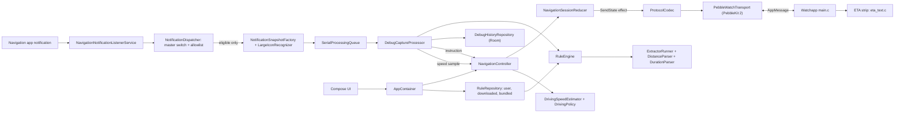
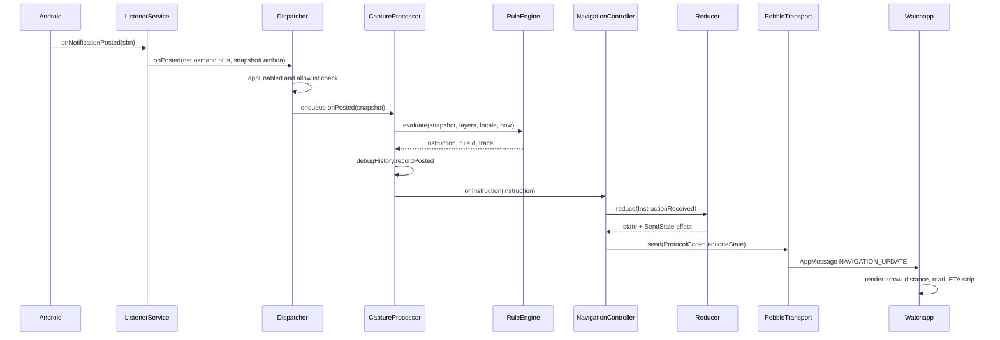
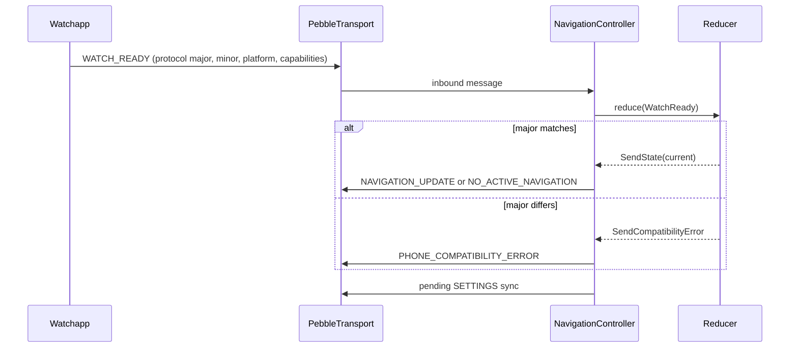
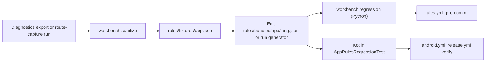

# Architecture

## Architecture Analysis

### System Overview

A two-device system with no server. An Android companion app (`android/app`) listens to navigation-app notifications, turns each one into a normalized `NavigationInstruction` with a declarative rule engine, reduces it into one session state, and sends that state over Pebble AppMessage (PebbleKit Android 2) to a C watchapp (`watchapp/`). The watchapp renders it and syncs its own settings back. Repository tooling (Python) generates the shared protocol constants, validates and regression-tests the rule data, and captures real notifications in an emulator.

### Architectural Style

**Modular monolith per device, event-driven pipeline, functional core.**

- One Android app module with feature packages (`notification`, `rules`, `core`, `pebble`, `protocol`, `data`, `ui`, ...), wired by hand in `di/AppContainer.kt` (no DI framework, per `spec/700-ai/CodingStandards.md`).
- Pure, deterministic core: `RuleEngine`, `ExtractorRunner`, `ConditionEvaluator`, `NavigationSessionReducer`, `ProtocolCodec`, `DrivingSpeedEstimator`, `WatchSettingsSync` take inputs and a clock and return values or effects; Android I/O stays at the edges (listener service, `PebbleWatchTransport`, Room, DataStore).
- Rules are data, not code: JSON rulesets interpreted by a closed set of operators and extractors (REQ-RULE-001/002).
- Single source of truth for the wire protocol: `protocol/protocol-definition.json` generates `Protocol.kt` and `protocol.h`.

### Component Relationships

Text fallback: the listener hands the package name to the dispatcher; only enabled, allowlisted packages get a snapshot built; a serial queue runs the capture processor, which evaluates the layered rules, records the event and trace in Room, and forwards a matched instruction and any speed sample to the navigation controller. The controller runs the pure reducer and the driving estimator, encodes `SendState` effects with the codec, and sends them through the PebbleKit transport to the watchapp, which renders the arrow, distance, road and ETA strip. The UI reaches everything through the container.

### Data Flow

1. **Intake**: `onNotificationPosted` → `NotificationDispatcher.onPosted(packageName) { snapshot }`. The content lambda runs only after the master switch and allowlist pass (AGENTS.md rule 7).
2. **Snapshot**: `NotificationSnapshotFactory` copies `title`, `text`, `subText`, `bigText`, `summaryText`, `infoText`, channel, category, template, progress, and the matched icon drawable name. `combinedText` joins the text fields with spaces.
3. **Field access**: `SnapshotFields.resolve` maps a rule field name to a value and turns Unicode space separators (NBSP) into ASCII spaces. Newlines in `bigText` are kept, so rules can address line 1 or 2 with `(?m)`.
4. **Evaluation**: `RuleEngine.evaluate(snapshot, layers, locale, now)` sorts user > downloaded > bundled, then priority descending, then id. It skips other rule families, disabled rules and other locales (language part of the phone locale), short-circuits conditions, and assembles the first match. It records a trace entry per evaluated rule. A regex timeout disables the rule for that run.
5. **Assembly**: maneuver token → `Maneuver.fromToken`; distance (`Num`) → non-negative Int; primary/secondary → text; `etaEpochSeconds` → `now + seconds` when the extractor is `duration`, otherwise the number as an absolute epoch; `stopsRemaining` → number or first integer in text.
6. **Session**: `NavigationSessionReducer` quantizes distance, carries the ETA within the session for 5 minutes, launches the watchapp once, deduplicates by `lastSentInstruction != instruction`, and flags stale states after 30 s.
7. **Wire**: `ProtocolCodec.encodeState` fits primary text to 64 bytes and secondary to 24 bytes on whole characters, and sends `ETA_EPOCH_SECONDS` only when set.
8. **Watch**: `main.c` stores the fields. The strip shows `secondaryText` ("ETA 17:45"), or in time-left mode a countdown from the epoch, else from the `HH:MM` in `secondaryText` (`eta_parse_clock_minutes`).

### Key Design Decisions

| Decision | Rationale (from code and spec) | Implication for change |
|---|---|---|
| Declarative closed extractor set | Remote rules must never execute code (REQ-RULE-002) | A new extraction ability means a new extractor type in the schema (hash-protected), the Kotlin model, the validator and the Python workbench |
| Phone locale picks rule language | Navigation apps follow the system language | A user whose OsmAnd language differs from the phone's gets no match |
| Distance needs an explicit unit | A bare number was the ETA hour ("23 m" bug, 2026-07-13) | Clock and duration text must never feed the distance extractor |
| ARRIVE at the bottom of localized ladders | Road names with arrival stems ("Zielstattstraße") | New localized rules keep the ladder order |
| Reducer dedup on instruction equality | Avoid spamming the watch and vibrations | An ETA epoch that changes every second defeats dedup; a minute-aligned one does not |
| Secondary text doubles as the ETA string | The watch labels it ETA and parses its clock | Putting a non-clock value (OsmAnd de: remaining km) there shows "ETA 3,3 km" |
| Rule data staged from `rules/` into assets and test resources | One source of truth for runtime and tests | Editing `rules/` changes app and tests together |

Security: notification content is read only after the allowlist check, the snapshot type has no place for intents, actions or images, and exports are redacted on request (spec/600-security-release). Remote official rule updates exist but are off (no public keys embedded).

### Improvement Opportunities

- Add an arrival-clock extractor (or a reusable clock-to-epoch utility) so rules can fill `etaEpochSeconds` from `HH:MM` text; inject the zone into the engine as `DrivingSpeedEstimator` already does.
- Localize `DurationParser` units if duration-based ETA is kept, and align epochs to the minute to protect dedup.
- Give `secondaryText` one meaning across rulesets (arrival clock), or document per-app semantics.
- Run the Kotlin rule regression on rules-only PRs (extend `android.yml` paths or `rules.yml`).
- Split `watchapp/src/c/main.c` (1,479 lines) and `DashboardScreen.kt` (673 lines).

## Interaction Diagrams

### Notification to watch (matched OsmAnd turn)

Text fallback: Android posts the notification; the listener passes the package to the dispatcher, which checks the switch and allowlist before queueing; the processor evaluates rules, records the event and forwards the instruction; the controller reduces it and sends the encoded state; the watch renders it.

### Watch connects or asks for state

Text fallback: on WATCH_READY the reducer either resends the current state or reports an incompatible protocol major; pending settings edits follow.

### Rule maintenance loop

Text fallback: captures are sanitized into fixtures, rules are edited (localized Google Maps through the generator), and both the Python and Kotlin regressions must pass in hooks and CI.
