# Architecture

## Architecture Analysis

### System Overview

A two-device monorepo. The Android companion (`android/app`, Kotlin/Compose) observes navigation notifications, normalizes them through a declarative rule engine and a pure session reducer, and pushes one current state to the Pebble watchapp (`watchapp/`, C) over PebbleKit Android 2 AppMessages. One JSON protocol definition (`protocol/`) generates the constants for both sides. Rule data, schemas and maintainer tools live beside the code.

### Architectural Style

A client-side, offline monolith per device, with a hexagonal flavour on the phone. Pure domain cores (`core/NavigationSessionReducer`, `rules/RuleEngine`, `protocol/ProtocolCodec`) are isolated from Android and PebbleKit behind interfaces (`WatchTransport`, `AppAllowlist`, `ReleaseFetcher`, `EpochClock`). Wiring is manual through `di/AppContainer` (no Hilt, by the coding standards). The watch is a single-window event loop that keeps pure, host-testable text modules apart from Pebble API code. There is no backend. The only network call is the GitHub Releases GET (still true at 6dec020: remote official rules have verification code but no download code, see [api-documentation.md](api-documentation.md) "External HTTP API").

### Component Relationships

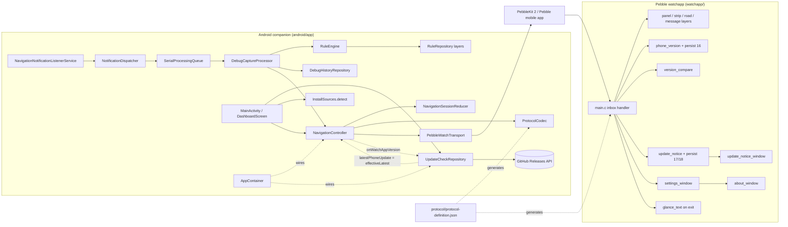

Text fallback: listener -> dispatcher (allowlist gate) -> serial queue -> capture processor -> rule engine -> navigation controller -> reducer -> codec -> PebbleKit transport -> Pebble mobile app -> watchapp inbox -> layers, phone-version record and update-notice record. UpdateCheckRepository calls GitHub and hands the effective newer version to the controller (`latestPhoneUpdate`); the controller hands back the watchapp version from a genuine WATCH_READY (`onWatchAppVersion`). The dashboard reads the update state and the install source. The watch compares versions in `version_compare`. AppContainer wires everything. The protocol JSON generates the Kotlin and C constants.

### Data Flow

1. A notification is posted. The master switch and package allowlist are checked on the package name only, and then a minimal snapshot is taken (no icons except rule-driven large-icon matching).
2. The rule engine produces a `NavigationInstruction`. Debug history stores the snapshot and trace, with keys hashed.
3. The controller reduces it into a `NavigationState` and effects (`LaunchWatchApp`, `SendState(state, flags)`, `SendCompatibilityError`). Flags are computed in the reducer from `WatchSettings` and staleness.
4. `ProtocolCodec.encodeState(state, flags, appVersion, latestPhoneVersion)` builds an `AppMessage`, always with protocol major/minor and `APP_VERSION`. When `latestPhoneVersion` is set, it ORs in flag bit 4 and adds key 14. Text is fitted to the watch buffers (64/24 UTF-8 bytes).
5. `PebbleWatchTransport.send` delivers it, with one relaunch-and-retry on `FailedDifferentAppOpen`. The controller retries up to 3 times with backoff.
6. The watch decodes the tuples, records the phone version (persist key 16) and the update state (key 17), renders, may show the update notice, and sets the glance when it exits.
7. Watch to phone: `WATCH_READY` (or a synthetic one from `onAppOpened`, or an autonomous READY 1.5 s after a launch) triggers a resend of the current state. The reducer reads the protocol major/minor. Since v0.0.73, `NavigationController.handleInbound` also passes key 11 of a genuine READY (`ProtocolCodec.watchAppVersion`) to `UpdateCheckRepository.recordWatchAppVersion`, which persists it as `watch_app_version`.

### Version Exchange (both directions)

- **Phone to watch**: key 11 `APP_VERSION` (`BuildConfig.VERSION_NAME`) on every state message, recorded and persisted on change by the watch (`phone_version_update`, main.c `record_phone_version`). The watch's own version is `APP_VERSION_STR` in main.c, kept equal to the phone's version line by `scripts/version.sh`.
- **Watch to phone**: key 11 only inside the watch's real `WATCH_READY`, sent once from `init()`. Since v0.0.73 the phone records it (`ProtocolCodec.watchAppVersion` -> `NavigationController.onWatchAppVersion` -> `UpdateCheckRepository.recordWatchAppVersion`, prefs key `watch_app_version`, exposed as `UpdateState.watchAppVersion`). The synthetic READYs carry no version and never record one. The Core Devices companion does forward the real READY once the watchapp declares `companionApp` (confirmed on a real phone with v0.0.74; the dashboard "Watchapp version (last seen)" row shows it). The earlier belief that it never forwards it is outdated. PebbleKit 2 reports watch firmware version only, so the real READY is the phone's only source for the watchapp version.

### Key Design Decisions

- **One state, never a queue** (REQ-ANDROID-010): newer state replaces pending state. It is persisted in Room for process recovery.
- **Generated protocol constants** with a DO-NOT-EDIT banner and a `--check` gate in CI and pre-commit. They must stay consistent with the integrity-protected `examples/protocol-definition.json`.
- **Synthetic readiness**: the phone synthesizes `WATCH_READY` (1.5 s after a launch, and on `onAppOpened`). Its recorded rationale, that the Core Devices companion does not forward the real one, is outdated (forwarding confirmed in v0.0.74 with `companionApp` declared); the mechanism still covers auto-launch off and the settle delay, and its comments need correcting.
- **Version compare is ungated by the online check**: `UpdateState.updateAvailable = githubNewer || watchNewer`, so the card and bit 4/key 14 appear from the watch version alone with no check ever run. Only the #94 stale prompt (`isCheckStale`: never checked or over 30 days) keys off the online check, and it does so regardless of the version-compare result.
- **Phone-wide update bit applied in the codec** (#94): `encodeState` adds bit 4 + key 14 on every state message, so the reducer's per-state flags stay unchanged and NO_ACTIVE_NAVIGATION also carries it.
- **Two update signals per device (v0.0.73)**: the phone's `UpdateState.effectiveLatest` is the higher of a newer GitHub tag (tolerant compare) and a strictly newer watchapp version (`AppVersions.isNewerStrict`); it drives the card and key 14. The watch combines the phone's bit 4/key 14 with its own `version_compare` of `APP_VERSION_STR` against the phone's key 11. Unparsable versions are never "newer".
- **Install-source-aware card (v0.0.73)**: `InstallSources.detect` (installer package, no network) picks the card's main source; `updateCardModel` is the pure choice of main source, other sources and the F-Droid delay line.
- **Privacy by construction**: allowlist before content, no automatic upload, network used only for the update check, which is opt-in for automatic runs.
- **Vendored PebbleKit 2** for F-Droid reproducibility.
- **One APK for every channel, install source decided at runtime**: there are no product flavours; the GitHub release APK is the bytes F-Droid's reproducible build must match (`Binaries:`, `AllowedAPKSigningKeys`), and `InstallSources.detect` picks the update behaviour once per app start. A Play-specific behaviour (#114) can follow the same runtime switch without a second build; the Play AAB from `play-release.yml` is built from the same sources and key.
- **Install source as an enum, decided once (checked at 494a6dd)**: `AppContainer.installSource` calls `InstallSources.detect` once per process; it keeps only the mapped enum (`GITHUB`, `FDROID`, `OBTAINIUM`, `PLAY`) and drops the installer package. A pure `UpdatePolicy.forSource` table (#114) turns the enum into update behaviour (GitHub check allowed, stored GitHub data ignored, other sources offered, delay note), read by `UpdateCheckRepository`, `updateCardModel`, `updatePrompt` and `DashboardScreen`. `GITHUB` is the fallback for a manual install, another store and a failed lookup, which is right for the card's destination but too coarse for #119's "installed manually" and export `unknown`. Detail: [code-quality-assessment.md](code-quality-assessment.md), "Install source findings".
- **Export metadata is mode-independent**: `ExportBuilder.build` writes one `ExportMetadata` for all three modes, so header data (versions, locale, user-added packages, and #119's install section) is in rules-only exports too; each schema bump adds a section to `spec/300-data/ExportFormat.md`.
- **Pure C units** for watch logic that can be tested on the host, one unit per test binary.
- **Settings change through one path**: every on-watch setting has a `settings_set_*` setter in `theme.c` that writes its persist key at once; the menus call it and then `notify_change()`, which runs `main.c` `on_settings_changed()` (window background, `redraw_all`, `apply_backlight`). Since v0.0.76 a Shortcut runs the same setters through `shortcut_apply()` and then `on_settings_changed()` itself. Everything else that depends on a setting reads it when it draws (theme colours, units, ETA mode and label, arrow side; the glyph cache flushes itself when the pack changes). The Shortcuts door's own setters (`settings_set_shortcut`, `settings_set_touch_enabled`) do not call `notify_change()`, so the `theme.c` setters are the only place every watch-side edit passes through (relevant to #102).
- **Watch settings are watch-only (as of 4779760)**: no setting travels in the protocol; REQ-WATCH-012/014/015/016/022/024 each say so. The phone's `WatchSettings` holds four separate phone-side behaviours that only shape FLAGS bits 0-2, and three of them have no UI (see [code-quality-assessment.md](code-quality-assessment.md), "Settings sync findings").
- **Touch through the system bridge, except on the navigation window (#53, #12)**: the app opts into the bridge (`app_touch_navigation_enable(true)`) so the menus, sub-lists, About and the update notice take touches as button presses, and disables it on the navigation window, so a stray swipe cannot act as BACK and close the app mid-route. Since v0.0.76 that window attaches a swipe and a tap recognizer that run the user's Shortcuts while Touch is on and `touch_service_is_enabled()` (REQ-WATCH-024).
- **One handshake per launch**: the watch sends `WATCH_READY` once, from `init()`. A Bluetooth reconnect while the app is open only restarts the connection watchdog (`app_connection_handler`); it sends no new READY. The watchapp registers no outbox sent/failed or inbox-dropped handler, so a busy outbox silently drops `send_ready`.
- **Rule families instead of copied package lists (#113, checked at 2fa2aa5)**: #113 did not follow the data-only plan recorded in the next bullet. A catalog entry may name another entry in `rulesFrom` (`microg-maps` -> `google-maps`); `NavigationAppCatalog.ruleFamilies()` groups packages by `rulesAppId`, and `RuleEngine`, `AssetRuleRepository`, `RulesViewModel`'s override engine and `IconCandidates` apply a rule to every package of its family (`RuleFamilies.applies`). On Google Play, `forGooglePlay()` merges an unlisted `rulesFrom` app's packages into its target entry instead, so the same family results. Resource lookups for the large icon still use the posting package only (`AppIconReferences`), which is what this intent changes. `RuleFamilies` records membership only, not which package is the root. Detail: [code-quality-assessment.md](code-quality-assessment.md), "MicroG icon fallback findings".
- **Package names are data, matched exactly, with no alias layer (checked at 1c7f4c1; superseded by the rule families above)**: a catalog entry lists every package an app publishes under, and every rule lists its own `packageNames`; the engine, the large-icon recognizer and the ruleset-version record each test `snapshot.packageName in rule.packageNames` (REQ-RULE-003, REQ-RULE-015). Nothing maps one package onto another app's rules. Enablement, the allowlist and the Navigation apps row work per catalog entry, so all packages of an app share one switch. A package variant (#54's alternative builds, #113's MicroG Maps) is therefore added to the catalog entry, to every rule of that app, to the manifest `<queries>` and to the fixtures, and a JVM test plus a Python check keep those in step. See [code-quality-assessment.md](code-quality-assessment.md), "MicroG Maps findings".

### Improvement Opportunities

- Split `watchapp/src/c/main.c` (1,261 lines) into decoding, rendering and lifecycle units, and validate tuple types.
- Add coverage tooling (Kover or JaCoCo) and a lint baseline.
- Done in v0.0.73: "update available" is now derived on each device from the GitHub result and the version comparison.
- `DashboardScreen` takes about 40 parameters; grouping the Status section inputs into one small model would ease further rows.
- Done in v0.0.75: the #94 stale prompt and the manual-check toast take the version-compare result into account (intent `261022-update-by-version-compar`).
- Done in v0.0.76: navigation-screen Shortcuts (#12) as the pure `shortcuts.c` unit, `shortcut_apply.c`, the banner in `main.c` and the Shortcuts door in `settings_window.c`.
- Play release (#114, intent `261025-play-release`, merged at 1c7f4c1): a `PLAY` install source with a pure "which update UI does this source show" model (in the style of `updateCardModel`) consumed by the dashboard, `MainActivity` and the start-up check; targetSdk 36 and a failing gate; privacy and Data safety docs that match the real network use. Detail in [code-quality-assessment.md](code-quality-assessment.md), "Play release findings".
- Settings sync (#102, intent `261025-settings-sync`, shipped in v0.0.77): a table-driven encode/decode of the 23 synced settings (one place mapping key, count and setter), a pure wrap-around revision unit on each side, a hook in the `theme.c` setters for watch-side edits, outbox retry on the watch, and a phone mirror repository plus a Compose screen. Detail and risks are in [code-quality-assessment.md](code-quality-assessment.md), "Settings sync findings".
- Install source (#119, active intent `261029-install-source`): detect once per start a plain install record (mapped source, installing, initiating and originating packages, first install and last update times) beside the enum, with a pure mapper and a pure row-text helper (the `watchAppVersionText` pattern), so the dashboard row and export schema 5 read one value; keep `InstallSource` and `UpdatePolicy` as they are for the card.
- MicroG icon fallback (intent `261028-microg-icon-fallback`, shipped in v0.0.79, not rescanned): record each family's root package explicitly (not by set order) and let `AppIconReferences` retry a missing drawable with it in the posting package's context; add a test seam for the identifier lookup.
- MicroG Maps (#113, intent `261026-microg-maps`, shipped in v0.0.78 with `rulesFrom` families rather than the data-only copies below): append `app.morphe.android.apps.maps` to the `google-maps` catalog entry, to the 150 Google Maps rules, to `<queries>` and to the fixtures, keeping `com.google.android.apps.maps` first. A catalog-driven alias (rules expanded from the catalog at load time) would remove the copies but changes the engine and the test that pins the package sets; the #54 data-only pattern needs no Kotlin production change.

## Interaction Diagrams

### Install source to the dashboard row and the export (current 494a6dd, with the #119 touchpoints)

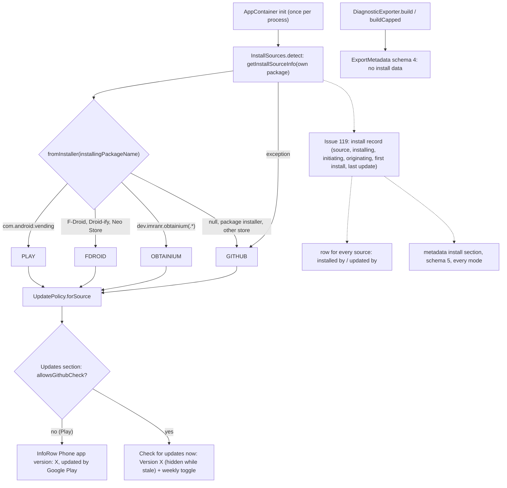

Text fallback: once per process `AppContainer` asks `PackageManager.getInstallSourceInfo` for its own package and maps only `installingPackageName`: the Play Store to PLAY, the three F-Droid clients to FDROID, Obtainium and its suffixed builds to OBTAINIUM, everything else and any failure to GITHUB. `UpdatePolicy` decides the update UI; only a Play install, which has no GitHub check, gets the "Phone app version" row, and other sources see the version only in the "Check for updates now" summary, which disappears while the stale item is shown. Exports carry no install data. #119 adds one install record, read from the same lookup plus `PackageInfo` times, that feeds a row for every source and an install section in every export (schema 5).

### Large-icon lookup for MicroG Maps with the proposed fallback (current code + this intent, 2fa2aa5)

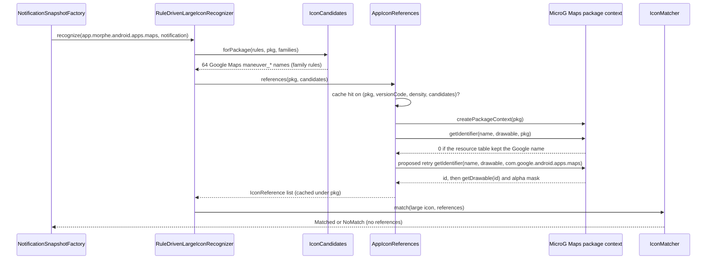

Text fallback: the recognizer takes its candidates from every enabled rule of the posting package's family, so MicroG Maps already gets the Google Maps drawable table. `AppIconReferences` opens MicroG Maps' own package context and looks each name up under `app.morphe.android.apps.maps`. Today a 0 there skips the drawable, and with none found the matcher returns "no references" and the card shows the fallback arrow. The proposed fix retries the same name with the family's root package (`com.google.android.apps.maps`) in the same MicroG Maps context, never in Google Maps' own context. The result is cached under the posting package as before.

### A MicroG Maps notification through the Google Maps rules (#113 target, 1c7f4c1)

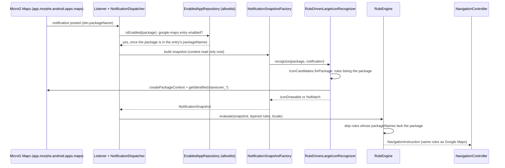

Text fallback: today the package is unknown, so it is never discovered and the allowlist drops it before content is read. Once `app.morphe.android.apps.maps` is in the `google-maps` catalog entry, the Google Maps switch enables it, the dispatcher admits it and the snapshot is built. The icon recognizer takes its drawable candidates from the rules that list the package and loads the `maneuver_*` drawables from MicroG Maps itself; whether they resolve under the renamed package is unverified, and without a match the card falls back to the neutral arrow with distance, road and ETA. The engine then evaluates only rules that list the package, so all 150 Google Maps rules must list it. The rest of the path to the watch is unchanged.

### Update UI by install source (as at 6dec020) and the #114 touchpoints

Superseded for Play at 494a6dd: `com.android.vending` maps to PLAY and the #114 behaviour below is implemented (see the first diagram).

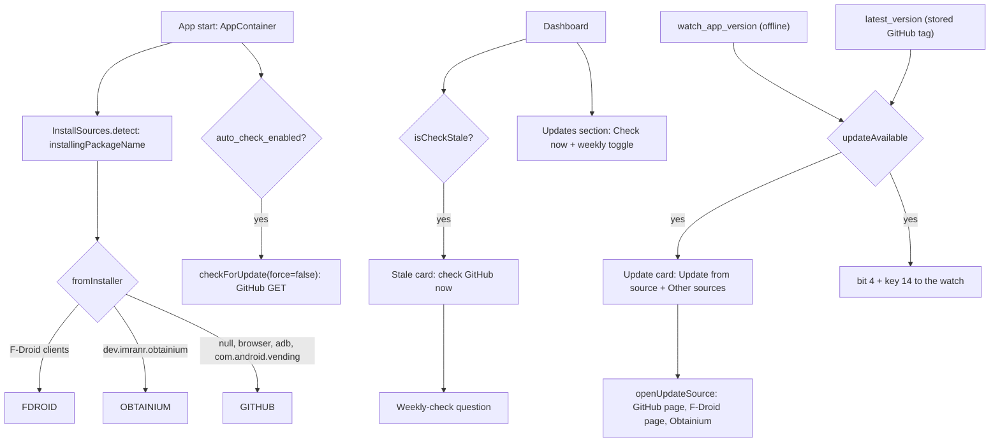

Text fallback: at start the app detects its install source; a Play install falls into GITHUB. When weekly checks are on, a GitHub GET runs. The dashboard shows the stale card (and then the weekly question) whenever the last GitHub check is never or over 30 days old, and the Updates section always offers the manual check and the weekly toggle. The stored watchapp version and the stored GitHub tag both make `updateAvailable`, which shows the card ("Update from {source}", "Other sources") and sets bit 4 and key 14 for the watch. For #114, a Play source would hide the stale card, weekly question, Updates rows, start-up check and "Other sources", ignore the stored GitHub tag, and send the card's button to the Play listing; the watch side is unchanged.

### Watch input and setting changes (current, 4779760, v0.0.76)

This is the surface the active intent `261025-settings-sync` (#102) hooks into: every path below ends in a `theme.c` setter.

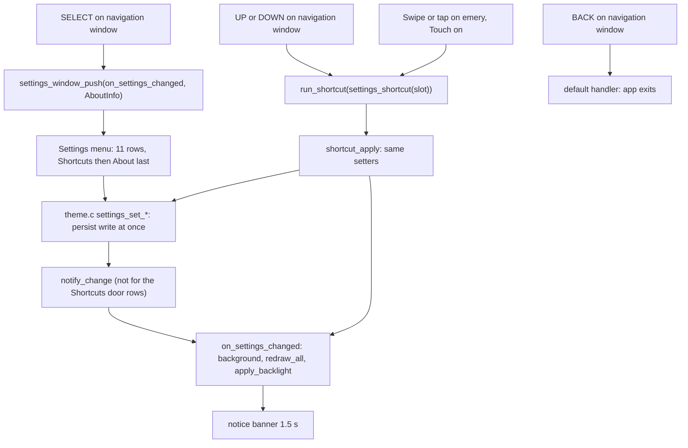

Text fallback: SELECT opens the 11-row settings menu. A menu choice calls a `theme.c` setter (persisted at once) and then `notify_change`, which re-applies the background, redraws and re-applies the backlight; the Shortcuts door's slot and Touch rows save without calling it. UP, DOWN and, on emery while Touch is on, a swipe or a tap run the slot's action through `shortcut_apply`, which uses the same setters, then `on_settings_changed` and a 1.5 s banner. BACK still exits.

### Settings today and the #102 touchpoints (current code, 4779760)

```mermaid
sequenceDiagram
  participant W as Watchapp main.c
  participant TH as theme.c setters + persist 1-15, 19-27
  participant PK as Pebble companion app
  participant S as WatchListenerService
  participant C as NavigationController
  participant WS as WatchSettingsRepository (prefs pebblentn_settings)
  W->>TH: settings_load() in init
  W->>PK: WATCH_READY once (EVENT, MAJOR, MINOR, APP_VERSION)
  PK-->>S: onAppOpened -> synthetic READY (phone's own MAJOR/MINOR)
  PK-->>S: onMessageReceived(real READY)
  S->>C: WatchInboundBus -> handleInbound -> decodeInbound(major, minor)
  C->>W: state message, FLAGS bits 0-2 from WatchSettings defaults
  Note over WS: only watch_auto_launch is stored; vibrate, backlight, exit-on-stop are fixed defaults
  Note over W,TH: a menu or Shortcut edit only persists on the watch; nothing is sent
```

Text fallback: the watch loads its settings from persist keys 1-15 and 19-27 and sends one READY with protocol and version only. The phone treats both the synthetic READY (which claims the phone's own protocol minor) and the real one as readiness, and sends state whose FLAGS bits 0-2 come from fixed `WatchSettings` defaults (only auto-launch is stored). Watch edits stay on the watch. #102 adds the settings to READY, a two-way SETTINGS event and a phone mirror.

### Navigation update reaches the watch

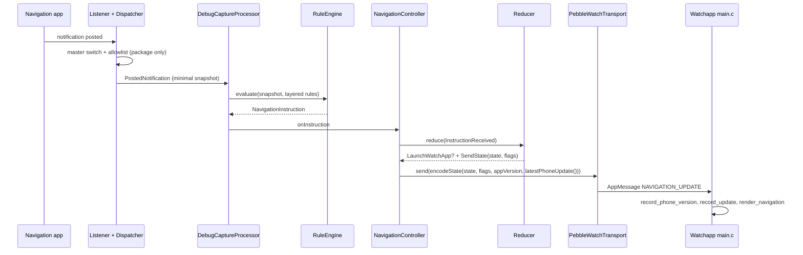

Text fallback: notification -> allowlist -> snapshot -> rule engine -> controller -> reducer effects -> codec (with the update fields) -> transport -> the watch records the versions and renders.

### Watch launch handshake

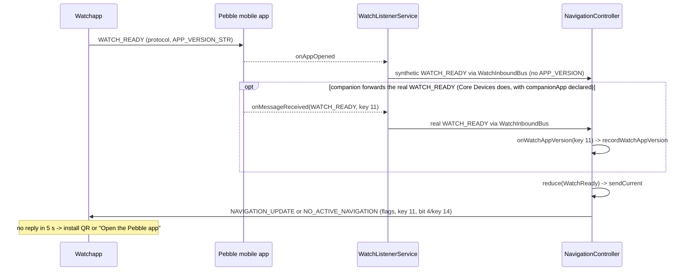

Text fallback: the watch sends READY with its version; the companion reports "app opened" and the listener emits a synthetic READY without a version. When the companion forwards the real READY (the Core Devices app does, confirmed in v0.0.74), its key 11 is recorded as the watchapp version. Either way the controller sends the current state. Without a reply in 5 s the watch shows a hint.

### Update check and #94 update notice (current behaviour)

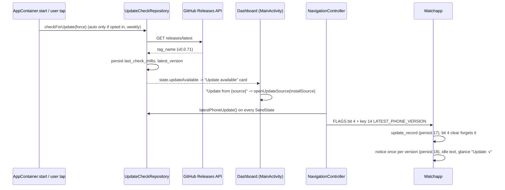

Text fallback: the GitHub check stores the latest tag. The dashboard shows the card, and its button opens the detected install source (GitHub releases page, F-Droid, or Obtainium). The controller adds bit 4 and key 14 to every state message while an update is known. The watch records it, shows the notice once per version when no route is active, swaps the idle text and sets the glance subtitle. A message with bit 4 clear erases it.

### Version-compare update (implemented in v0.0.73)

This was the proposal diagram of intent `261022-version-compare-update`; it is now implemented and merged. Both halves were re-verified against the code at 8f08e02 (v0.0.74), including the watch's `version_compare.c` (`version_effective_update`).

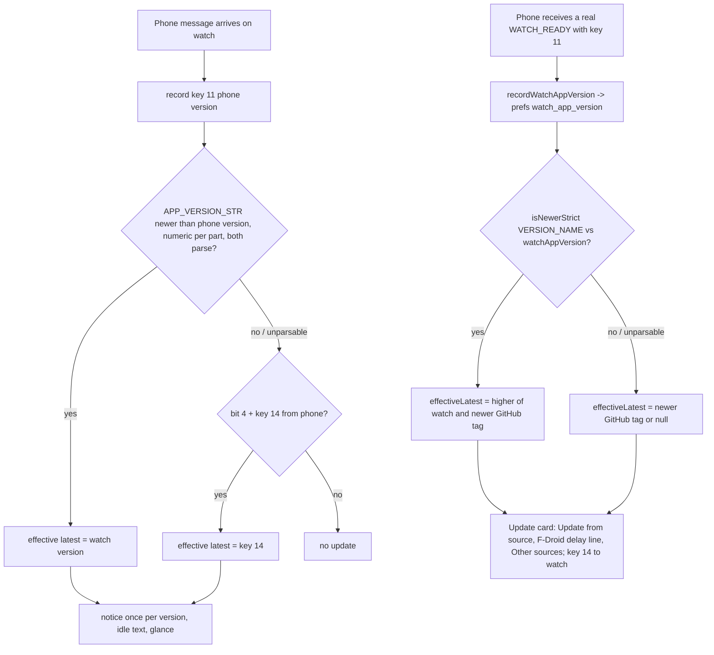

Text fallback: on the watch, the received phone version is compared with the watch's own version, and a higher watch version becomes the effective update version alongside the phone-reported bit 4/key 14. Unparsable versions are ignored. On the phone, a watch version is recorded only when a real WATCH_READY is forwarded. `UpdateState.effectiveLatest` is the higher of a strictly newer watch version and a newer GitHub tag; it feeds the card ("Update from {source}", the F-Droid delay line, "Other sources") and key 14.

### Dashboard watchapp version status row (implemented in v0.0.74)

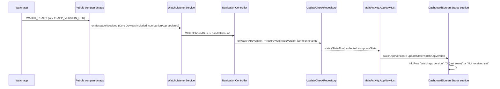

Text fallback: the companion forwards the watch's real WATCH_READY (confirmed with the Core Devices app on a real phone with v0.0.74). The controller records its key 11 in UpdateCheckRepository (prefs `watch_app_version`), and the dashboard shows it through `watchAppVersionText` as "X (last seen)", or "Not received yet" when none is stored.

### Update signals and the #94 prompts on the dashboard (current, 8f08e02)

This is the interplay the intent `261022-update-by-version-compar` changed: version compare should be the default signal, with the GitHub check kept as an optional extra.

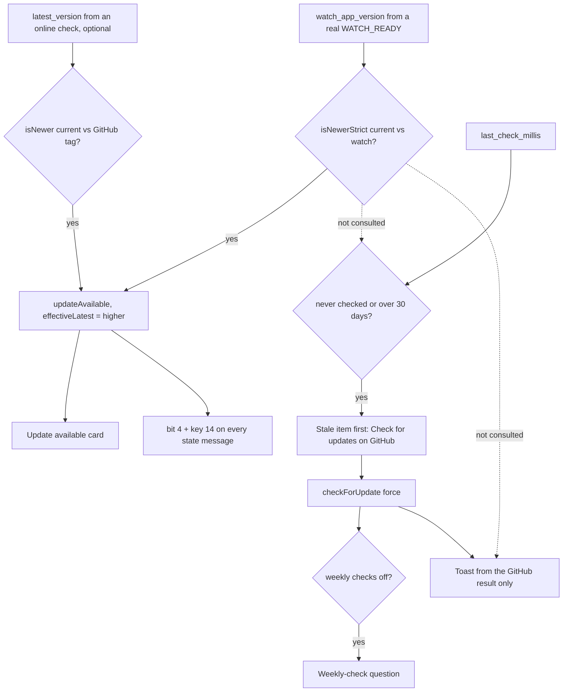

Text fallback: the card and bit 4/key 14 follow `updateAvailable` and `effectiveLatest`, which a strictly newer watch version satisfies with no online check ever run. Separately, `last_check_millis` alone decides the stale item: never checked (every fresh install) or over 30 days old puts "Check for updates" (GitHub) first on the dashboard, even when version compare already shows the card or proves the app current. A check started from it leads to the weekly-check question when weekly checks are off. The manual check's toast reports the GitHub result only, so it can say "up to date" while the card shows a version-compare update. The watch side (`effective_update()`) is independent of all of this.
