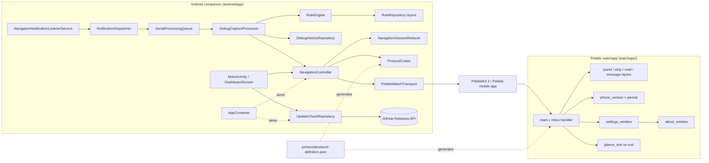
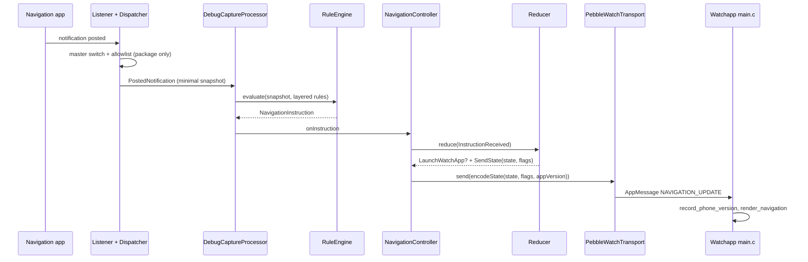
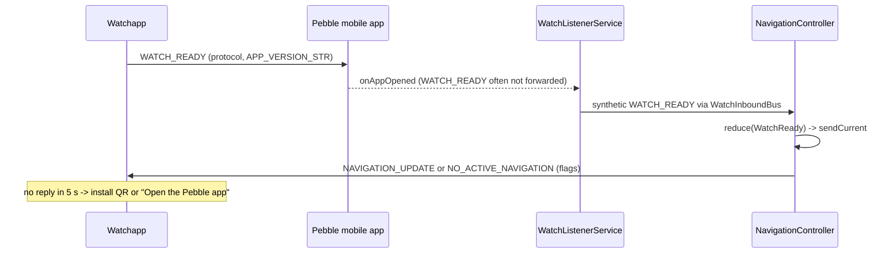
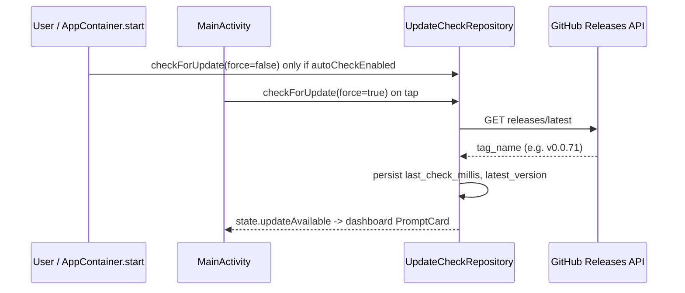

# Architecture

## Architecture Analysis

### System Overview

A two-device monorepo. The Android companion (`android/app`, Kotlin/Compose) observes navigation notifications, normalizes them through a declarative rule engine and a pure session reducer, and pushes one current state to the Pebble watchapp (`watchapp/`, C) over PebbleKit Android 2 AppMessages. One JSON protocol definition (`protocol/`) generates the constants for both sides. Rule data, schemas and maintainer tools live beside the code.

### Architectural Style

A client-side, offline monolith per device, with a hexagonal flavour on the phone. Pure domain cores (`core/NavigationSessionReducer`, `rules/RuleEngine`, `protocol/ProtocolCodec`) are isolated from Android and PebbleKit behind interfaces (`WatchTransport`, `AppAllowlist`, `ReleaseFetcher`, `EpochClock`). Wiring is manual through `di/AppContainer` (no Hilt, by the coding standards). The watch is a single-window event loop that keeps pure, host-testable text modules apart from Pebble API code. There is no backend. The only network call is the GitHub Releases GET.

### Component Relationships

Text fallback: listener -> dispatcher (allowlist gate) -> serial queue -> capture processor -> rule engine -> navigation controller -> reducer -> codec -> PebbleKit transport -> Pebble mobile app -> watchapp inbox -> layers. Separately, the dashboard drives UpdateCheckRepository, which calls GitHub. AppContainer wires everything. The protocol JSON generates the Kotlin and C constants.

### Data Flow

1. A notification is posted. The master switch and package allowlist are checked on the package name only, and then a minimal snapshot is taken (no icons except rule-driven large-icon matching).
2. The rule engine produces a `NavigationInstruction`. Debug history stores the snapshot and trace, with keys hashed.
3. The controller reduces it into a `NavigationState` and effects (`LaunchWatchApp`, `SendState(state, flags)`, `SendCompatibilityError`). Flags are computed in the reducer from `WatchSettings` and staleness.
4. `ProtocolCodec.encodeState` builds an `AppMessage`, always with protocol major/minor and `APP_VERSION`. Text is fitted to the watch buffers (64/24 UTF-8 bytes).
5. `PebbleWatchTransport.send` delivers it, with one relaunch-and-retry on `FailedDifferentAppOpen`. The controller retries up to 3 times with backoff.
6. The watch decodes the tuples, records the phone version (persist key 16), renders, and sets the glance when it exits.
7. Watch to phone: `WATCH_READY` (or a synthetic one from `onAppOpened`, or an autonomous READY 1.5 s after a launch) triggers a resend of the current state.

### Key Design Decisions

- **One state, never a queue** (REQ-ANDROID-010): newer state replaces pending state. It is persisted in Room for process recovery.
- **Generated protocol constants** with a DO-NOT-EDIT banner and a `--check` gate in CI and pre-commit. They must stay consistent with the integrity-protected `examples/protocol-definition.json`.
- **Synthetic readiness**: the Core Devices companion does not forward `WATCH_READY`, so the phone synthesizes it.
- **Privacy by construction**: allowlist before content, no automatic upload, network used only for the update check, which is opt-in for automatic runs.
- **Vendored PebbleKit 2** for F-Droid reproducibility.
- **Pure C units** for watch logic that can be tested on the host.

### Improvement Opportunities

- Split `watchapp/src/c/main.c` (1,124 lines) into decoding, rendering and lifecycle units, and validate tuple types.
- Give phone-wide flags (such as a future update-available bit) one place to be applied. The reducer currently hard-codes `flags = 0` for `NoActiveNavigation`.
- Add coverage tooling (Kover or JaCoCo) and a lint baseline.

## Interaction Diagrams

### Navigation update reaches the watch

Text fallback: notification -> allowlist -> snapshot -> rule engine -> controller -> reducer effects -> codec -> transport -> watch renders and records the phone version.

### Watch launch handshake

Text fallback: the watch sends READY; the companion reports the app as opened; the listener emits a synthetic READY; the controller sends the current state. Without a reply in 5 s the watch shows a hint.

### Update check (current behaviour)

Text fallback: a check runs on start when auto-check is on (weekly throttle) or on a manual tap. It calls GitHub, persists the time and tag, and the dashboard shows the update card. Today no update information reaches the watch.
