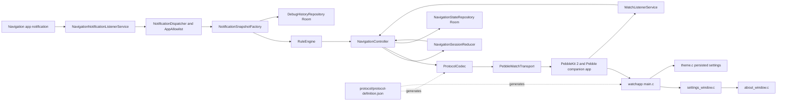
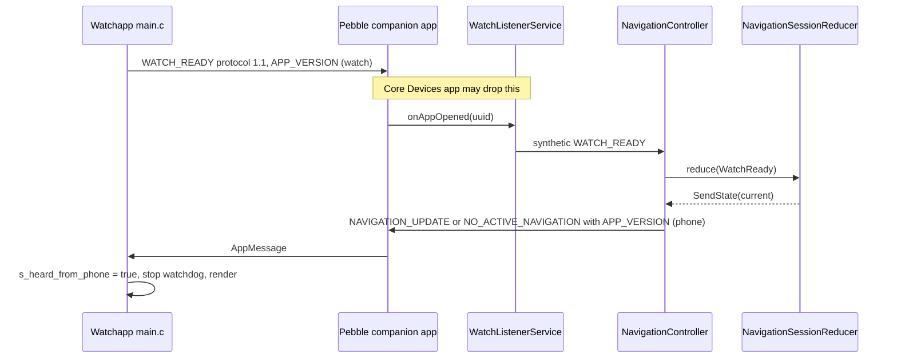
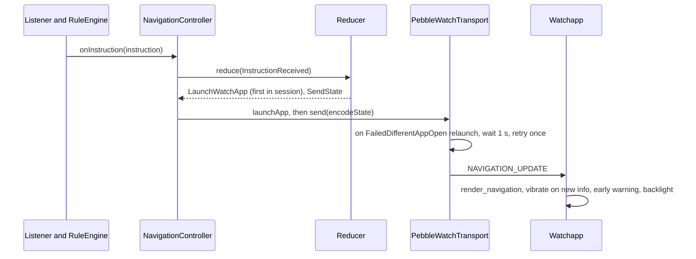
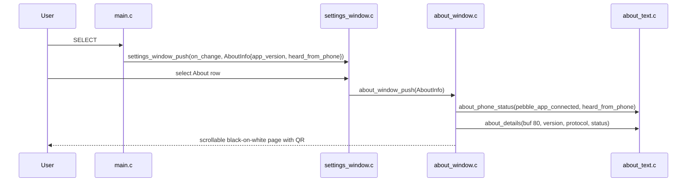

# Architecture

## Architecture Analysis

### System Overview

A monorepo with two runtime programs joined by a generated AppMessage protocol: an event-driven Android companion (Kotlin) and a Pebble watchapp (C). Supporting Python tooling generates the protocol constants, validates rules and drives emulator regression runs.

### Architectural Style

Two-tier device pair (phone + watch), each side a small monolith.
- **Phone**: a pipeline into a pure, deterministic reducer (functional core, imperative shell). Services and UI feed `ReducerEvent`s; the reducer returns a new `ReducerState` plus `ReducerEffect`s; `NavigationController` runs the effects against a `WatchTransport` interface. Dependencies are wired by hand in `di/AppContainer.kt` (no Hilt).
- **Watch**: a single event loop (`app_event_loop`) with one navigation window, a settings window tree and an About window. Pure logic is split into Pebble-free C units that compile on the host for testing.

### Component Relationships

Text fallback: notification -> listener -> allowlist dispatcher -> snapshot -> rule engine -> controller <-> reducer; controller -> codec -> PebbleKit transport -> Pebble companion app -> watchapp main.c, which opens settings and About and reads persisted settings from theme.c. Watch messages come back through WatchListenerService into the controller. The controller persists state in Room; snapshots feed debug history. protocol-definition.json generates both Protocol.kt (used by the codec) and protocol.h (used by the watch).

### Data Flow

1. A notification from an allowlisted package becomes a `NotificationSnapshot` (selected text fields only).
2. `RuleEngine` evaluates user, then official layers and produces a `NavigationInstruction` or nothing; the attempt is recorded in debug history.
3. `NavigationSessionReducer` deduplicates, quantizes distance, detects session start/stop and staleness, and decides effects.
4. `ProtocolCodec.encodeState` builds an AppMessage; texts are cut to the watch's byte budgets (64 and 24 bytes).
5. The watch decodes tuples by generated key numbers, stores them in static buffers and redraws.

Persisted state: phone in Room (schema v8) and DataStore; watch in Pebble `persist_*` storage, used only for on-watch settings (keys 1-15 in theme.c). Details in [component-inventory.md](component-inventory.md).

### Key Design Decisions

- **Generated protocol** shared by both sides; unknown keys are ignored, a different major version yields an explicit error state (spec/200-architecture/Protocol.md).
- **Synthesized readiness**: the Core Devices Pebble app does not forward the watch's WATCH_READY, so the phone fakes readiness after launch (`scheduleAutonomousReady`) and on `onAppOpened` (spec/200-architecture/Pebble.md).
- **Relaunch on `FailedDifferentAppOpen`**: the transport relaunches the watchapp once and retries, only for a real pending update (REQ-WATCH-006).
- **Watch-side features stay off the wire**: appearance, ETA mode, backlight, vibration, early warning and About are all watch-only and "SHALL NOT change the protocol" (REQ-WATCH-011 to -022).
- **Handshake watchdog on the watch**: any inbound message sets `s_heard_from_phone`; after 5 s without one the watch shows an install QR or "Open the Pebble app" (REQ-WATCH-017).
- **Vendored PebbleKit 2** from source for F-Droid reproducible builds.

### Improvement Opportunities

- Split watchapp/src/c/main.c (rendering, handshake, backlight, vibration, AppMessage in one 1078-line file).
- Run the watch host unit tests in CI. Both items are tracked in [code-quality-assessment.md](code-quality-assessment.md).

## Interaction Diagrams

### Startup handshake and state delivery

Text fallback: the watch sends WATCH_READY with its protocol and version. The companion may drop it, but forwards onAppOpened, which WatchListenerService turns into a synthetic WATCH_READY for the controller. The reducer answers with SendState; the controller sends the current state (always carrying the phone's APP_VERSION) through the companion; the watch marks the phone as heard, stops the watchdog and renders.

### Navigation update

Text fallback: a parsed instruction enters the controller, the reducer decides to launch (once per session) and send; the transport sends, relaunching and retrying once if the watchapp is not in front; the watch renders, buzzes only on new information and applies backlight.

### About screen (intent area)

Text fallback: SELECT on the navigation screen pushes settings with an AboutInfo snapshot (watch version, heard-from-phone flag). Choosing About pushes the About window, which asks about_text for the phone status line and the details text (into an 80-byte buffer) and shows a scrollable page with the install QR. The phone's version is not part of AboutInfo today.
