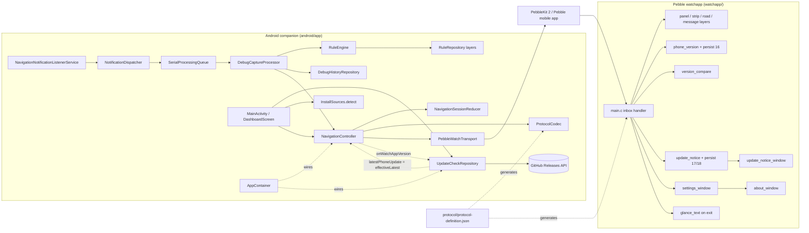
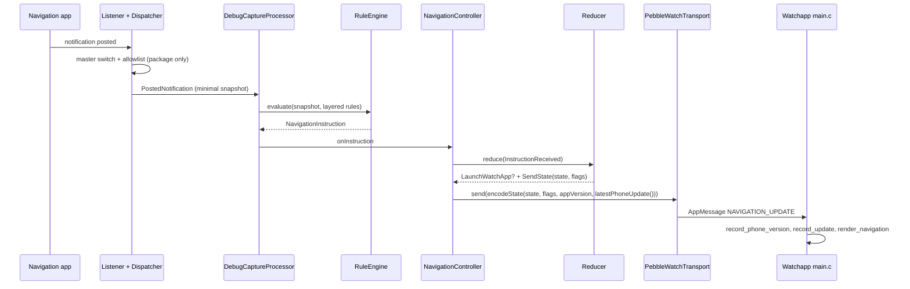
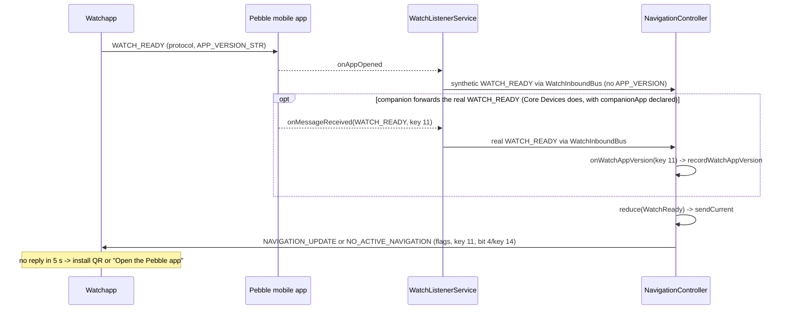
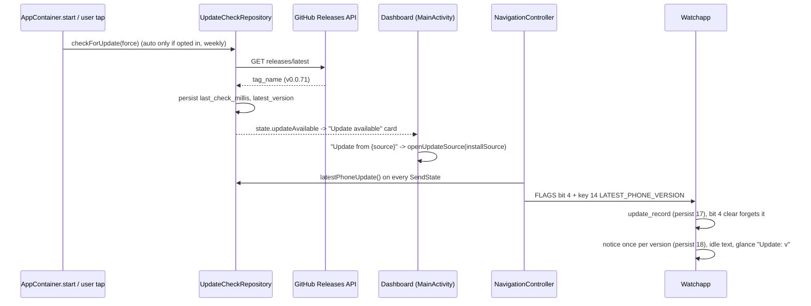
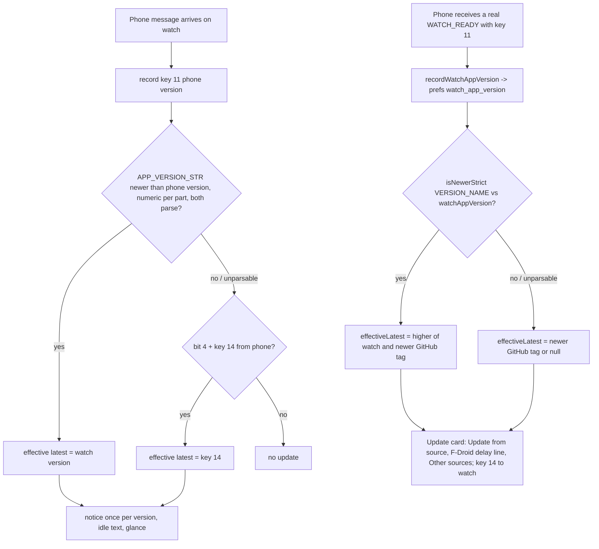
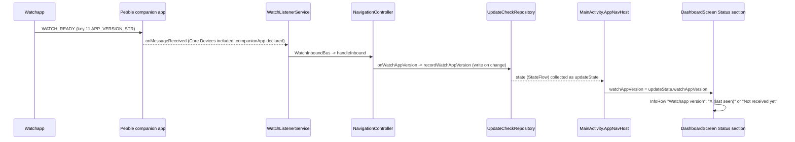
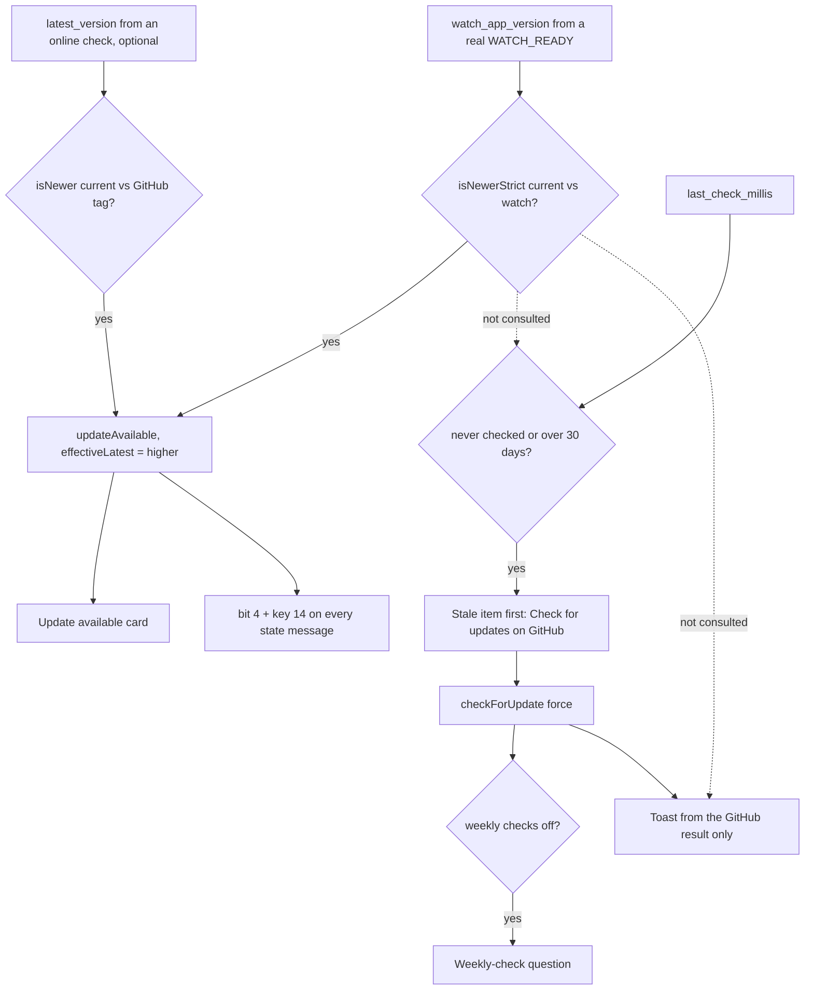

# Architecture

## Architecture Analysis

### System Overview

A two-device monorepo. The Android companion (`android/app`, Kotlin/Compose) observes navigation notifications, normalizes them through a declarative rule engine and a pure session reducer, and pushes one current state to the Pebble watchapp (`watchapp/`, C) over PebbleKit Android 2 AppMessages. One JSON protocol definition (`protocol/`) generates the constants for both sides. Rule data, schemas and maintainer tools live beside the code.

### Architectural Style

A client-side, offline monolith per device, with a hexagonal flavour on the phone. Pure domain cores (`core/NavigationSessionReducer`, `rules/RuleEngine`, `protocol/ProtocolCodec`) are isolated from Android and PebbleKit behind interfaces (`WatchTransport`, `AppAllowlist`, `ReleaseFetcher`, `EpochClock`). Wiring is manual through `di/AppContainer` (no Hilt, by the coding standards). The watch is a single-window event loop that keeps pure, host-testable text modules apart from Pebble API code. There is no backend. The only network call is the GitHub Releases GET.

### Component Relationships

Text fallback: listener -> dispatcher (allowlist gate) -> serial queue -> capture processor -> rule engine -> navigation controller -> reducer -> codec -> PebbleKit transport -> Pebble mobile app -> watchapp inbox -> layers, phone-version record and update-notice record. UpdateCheckRepository calls GitHub and hands the effective newer version to the controller (`latestPhoneUpdate`); the controller hands back the watchapp version from a genuine WATCH_READY (`onWatchAppVersion`). The dashboard reads the update state and the install source. The watch compares versions in `version_compare`. AppContainer wires everything. The protocol JSON generates the Kotlin and C constants.

### Data Flow

1. A notification is posted. The master switch and package allowlist are checked on the package name only, and then a minimal snapshot is taken (no icons except rule-driven large-icon matching).
2. The rule engine produces a `NavigationInstruction`. Debug history stores the snapshot and trace, with keys hashed.
3. The controller reduces it into a `NavigationState` and effects (`LaunchWatchApp`, `SendState(state, flags)`, `SendCompatibilityError`). Flags are computed in the reducer from `WatchSettings` and staleness.
4. `ProtocolCodec.encodeState(state, flags, appVersion, latestPhoneVersion)` builds an `AppMessage`, always with protocol major/minor and `APP_VERSION`. When `latestPhoneVersion` is set, it ORs in flag bit 4 and adds key 14. Text is fitted to the watch buffers (64/24 UTF-8 bytes).
5. `PebbleWatchTransport.send` delivers it, with one relaunch-and-retry on `FailedDifferentAppOpen`. The controller retries up to 3 times with backoff.
6. The watch decodes the tuples, records the phone version (persist key 16) and the update state (key 17), renders, may show the update notice, and sets the glance when it exits.
7. Watch to phone: `WATCH_READY` (or a synthetic one from `onAppOpened`, or an autonomous READY 1.5 s after a launch) triggers a resend of the current state. The reducer reads the protocol major/minor. Since v0.0.73, `NavigationController.handleInbound` also passes key 11 of a genuine READY (`ProtocolCodec.watchAppVersion`) to `UpdateCheckRepository.recordWatchAppVersion`, which persists it as `watch_app_version`.

### Version Exchange (both directions)

- **Phone to watch**: key 11 `APP_VERSION` (`BuildConfig.VERSION_NAME`) on every state message, recorded and persisted on change by the watch (`phone_version_update`, main.c `record_phone_version`). The watch's own version is `APP_VERSION_STR` in main.c, kept equal to the phone's version line by `scripts/version.sh`.
- **Watch to phone**: key 11 only inside the watch's real `WATCH_READY`, sent once from `init()`. Since v0.0.73 the phone records it (`ProtocolCodec.watchAppVersion` -> `NavigationController.onWatchAppVersion` -> `UpdateCheckRepository.recordWatchAppVersion`, prefs key `watch_app_version`, exposed as `UpdateState.watchAppVersion`). The synthetic READYs carry no version and never record one. The Core Devices companion does forward the real READY once the watchapp declares `companionApp` (confirmed on a real phone with v0.0.74; the dashboard "Watchapp version (last seen)" row shows it). The earlier belief that it never forwards it is outdated. PebbleKit 2 reports watch firmware version only, so the real READY is the phone's only source for the watchapp version.

### Key Design Decisions

- **One state, never a queue** (REQ-ANDROID-010): newer state replaces pending state. It is persisted in Room for process recovery.
- **Generated protocol constants** with a DO-NOT-EDIT banner and a `--check` gate in CI and pre-commit. They must stay consistent with the integrity-protected `examples/protocol-definition.json`.
- **Synthetic readiness**: the phone synthesizes `WATCH_READY` (1.5 s after a launch, and on `onAppOpened`). Its recorded rationale, that the Core Devices companion does not forward the real one, is outdated (forwarding confirmed in v0.0.74 with `companionApp` declared); the mechanism still covers auto-launch off and the settle delay, and its comments need correcting.
- **Version compare is ungated by the online check**: `UpdateState.updateAvailable = githubNewer || watchNewer`, so the card and bit 4/key 14 appear from the watch version alone with no check ever run. Only the #94 stale prompt (`isCheckStale`: never checked or over 30 days) keys off the online check, and it does so regardless of the version-compare result.
- **Phone-wide update bit applied in the codec** (#94): `encodeState` adds bit 4 + key 14 on every state message, so the reducer's per-state flags stay unchanged and NO_ACTIVE_NAVIGATION also carries it.
- **Two update signals per device (v0.0.73)**: the phone's `UpdateState.effectiveLatest` is the higher of a newer GitHub tag (tolerant compare) and a strictly newer watchapp version (`AppVersions.isNewerStrict`); it drives the card and key 14. The watch combines the phone's bit 4/key 14 with its own `version_compare` of `APP_VERSION_STR` against the phone's key 11. Unparsable versions are never "newer".
- **Install-source-aware card (v0.0.73)**: `InstallSources.detect` (installer package, no network) picks the card's main source; `updateCardModel` is the pure choice of main source, other sources and the F-Droid delay line.
- **Privacy by construction**: allowlist before content, no automatic upload, network used only for the update check, which is opt-in for automatic runs.
- **Vendored PebbleKit 2** for F-Droid reproducibility.
- **Pure C units** for watch logic that can be tested on the host, one unit per test binary.

### Improvement Opportunities

- Split `watchapp/src/c/main.c` (1,261 lines) into decoding, rendering and lifecycle units, and validate tuple types.
- Add coverage tooling (Kover or JaCoCo) and a lint baseline.
- Done in v0.0.73: "update available" is now derived on each device from the GitHub result and the version comparison.
- `DashboardScreen` takes about 40 parameters; grouping the Status section inputs into one small model would ease further rows.
- Let the #94 stale prompt and the manual-check toast take the version-compare result into account, so the online check stops acting as the default (active intent `261022-update-by-version-compar`).

## Interaction Diagrams

### Navigation update reaches the watch

Text fallback: notification -> allowlist -> snapshot -> rule engine -> controller -> reducer effects -> codec (with the update fields) -> transport -> the watch records the versions and renders.

### Watch launch handshake

Text fallback: the watch sends READY with its version; the companion reports "app opened" and the listener emits a synthetic READY without a version. When the companion forwards the real READY (the Core Devices app does, confirmed in v0.0.74), its key 11 is recorded as the watchapp version. Either way the controller sends the current state. Without a reply in 5 s the watch shows a hint.

### Update check and #94 update notice (current behaviour)

Text fallback: the GitHub check stores the latest tag. The dashboard shows the card, and its button opens the detected install source (GitHub releases page, F-Droid, or Obtainium). The controller adds bit 4 and key 14 to every state message while an update is known. The watch records it, shows the notice once per version when no route is active, swaps the idle text and sets the glance subtitle. A message with bit 4 clear erases it.

### Version-compare update (implemented in v0.0.73)

This was the proposal diagram of intent `261022-version-compare-update`; it is now implemented and merged. Both halves were re-verified against the code at 8f08e02 (v0.0.74), including the watch's `version_compare.c` (`version_effective_update`).

Text fallback: on the watch, the received phone version is compared with the watch's own version, and a higher watch version becomes the effective update version alongside the phone-reported bit 4/key 14. Unparsable versions are ignored. On the phone, a watch version is recorded only when a real WATCH_READY is forwarded. `UpdateState.effectiveLatest` is the higher of a strictly newer watch version and a newer GitHub tag; it feeds the card ("Update from {source}", the F-Droid delay line, "Other sources") and key 14.

### Dashboard watchapp version status row (implemented in v0.0.74)

Text fallback: the companion forwards the watch's real WATCH_READY (confirmed with the Core Devices app on a real phone with v0.0.74). The controller records its key 11 in UpdateCheckRepository (prefs `watch_app_version`), and the dashboard shows it through `watchAppVersionText` as "X (last seen)", or "Not received yet" when none is stored.

### Update signals and the #94 prompts on the dashboard (current, 8f08e02)

This is the interplay the active intent `261022-update-by-version-compar` changes: version compare should be the default signal, with the GitHub check kept as an optional extra.

Text fallback: the card and bit 4/key 14 follow `updateAvailable` and `effectiveLatest`, which a strictly newer watch version satisfies with no online check ever run. Separately, `last_check_millis` alone decides the stale item: never checked (every fresh install) or over 30 days old puts "Check for updates" (GitHub) first on the dashboard, even when version compare already shows the card or proves the app current. A check started from it leads to the weekly-check question when weekly checks are off. The manual check's toast reports the GitHub result only, so it can say "up to date" while the card shows a version-compare update. The watch side (`effective_update()`) is independent of all of this.
