# Architecture

## Architecture Analysis

### System Overview

A two-device monorepo. The Android companion (`android/app`, Kotlin/Compose) observes navigation notifications, normalizes them through a declarative rule engine and a pure session reducer, and pushes one current state to the Pebble watchapp (`watchapp/`, C) over PebbleKit Android 2 AppMessages. Since protocol 1.3 (#102) the watch also sends its 23 settings to the phone, which mirrors and edits them. One JSON protocol definition (`protocol/`) generates the constants for both sides. Rule data, schemas and maintainer tools live beside the code.

### Architectural Style

A client-side, offline monolith per device, with a hexagonal flavour on the phone. Pure domain cores (`core/NavigationSessionReducer`, `core/WatchSettingsSync`, `rules/RuleEngine`, `protocol/ProtocolCodec`) are isolated from Android and PebbleKit behind interfaces (`WatchTransport`, `WatchSettingsStore`, `AppAllowlist`, `ReleaseFetcher`, `EpochClock`). Wiring is manual through `di/AppContainer` (no Hilt, by the coding standards). The watch is a single-window event loop that keeps pure, host-testable units (text, decisions, the settings table, the revision) apart from Pebble API code. There is no backend. The only network call is the GitHub Releases GET (see [api-documentation.md](api-documentation.md) "External HTTP API").

### Component Relationships

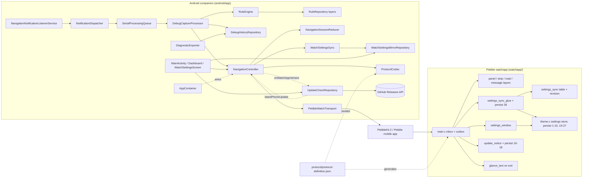

Text fallback: listener -> dispatcher (allowlist gate) -> serial queue -> capture processor -> rule engine -> navigation controller -> reducer -> codec -> PebbleKit transport -> Pebble mobile app -> watchapp inbox -> layers. The controller also runs the settings sync beside the reducer: watch settings arriving in a real READY or a SETTINGS message are merged by `WatchSettingsSync` into the persisted mirror, and phone edits from the Watch settings screen go back as SETTINGS while the watchapp is open. On the watch, the glue unit writes and applies settings messages using the pure table and revision units, and `theme.c` stores the values. The dashboard and exporter read the update state and debug history. The protocol JSON generates the Kotlin and C constants.

### Data Flow

1. A notification is posted. The master switch and package allowlist are checked on the package name only, and then a minimal snapshot is taken (text fields, `progress`/`progressMax`, times, and a matched drawable name for icon rules).
2. The rule engine produces a `NavigationInstruction`. Debug history stores the snapshot and trace, with keys hashed, grouping repeats of the same card.
3. Only the instruction goes on to the controller (`onMatchedInstruction`); the snapshot's other fields stop at the capture processor. The controller reduces it into a `NavigationState` and effects (`LaunchWatchApp`, `SendState(state, flags)`, `SendCompatibilityError`). Distances are quantized in the reducer. Flags come from the phone's `WatchSettings` and staleness.
4. `ProtocolCodec.encodeState(state, flags, appVersion, latestPhoneVersion)` builds an `AppMessage`, always with protocol major/minor and `APP_VERSION`, plus bit 4 and key 14 while an update is known. Text is fitted to the watch buffers (64/24 UTF-8 bytes).
5. `PebbleWatchTransport.send` delivers it, relaunching the watchapp once and retrying on `FailedDifferentAppOpen` while auto-launch is on. The controller retries up to 3 times with backoff.
6. The watch decodes the tuples, records the phone version (persist key 16) and the update state (key 17), renders, buzzes per its own settings (New instruction pattern, early warning), may show the update notice, and sets the glance when it exits.
7. Watch to phone: `WATCH_READY` (with settings, revision, platform and capabilities since 1.3), SETTINGS after each watch edit and on reconnect, or a synthetic READY from `onAppOpened` or 1.5 s after a phone launch, triggers a resend of the current state. A genuine READY's key 11 is recorded as the watchapp version; its settings go to the mirror.

### Version Exchange (both directions)

- **Phone to watch**: key 11 `APP_VERSION` (`BuildConfig.VERSION_NAME`) on every state message, recorded and persisted on change by the watch. The watch's own version is `APP_VERSION_STR` in main.c (0.0.81 at 61787f5), kept equal to the phone's version line by `scripts/version.sh`.
- **Watch to phone**: key 11 only inside the watch's real `WATCH_READY`. The phone records it (`ProtocolCodec.watchAppVersion` -> `NavigationController.onWatchAppVersion` -> `UpdateCheckRepository.recordWatchAppVersion`). The synthetic READYs carry no version and never record one; `ProtocolCodec.realWatchReadyMinor` uses the same test to tell a real READY's protocol minor (below 3 marks the watchapp outdated for settings).

### Key Design Decisions

- **One state, never a queue** (REQ-ANDROID-010): newer state replaces pending state. It is persisted in Room for process recovery.
- **Generated protocol constants** with a DO-NOT-EDIT banner and a `--check` gate in CI and pre-commit. They must stay consistent with the integrity-protected `examples/protocol-definition.json`.
- **Synthetic readiness**: the phone synthesizes `WATCH_READY` (1.5 s after a launch, and on `onAppOpened`). The Core Devices companion does forward the real one once the watchapp declares `companionApp`; the synthetic one stays as a fallback for auto-launch off and the settle delay.
- **Launch policy (REQ-WATCH-005/006)**: the reducer emits `LaunchWatchApp` once per session while auto-launch is on (`launchedSessionId`); the transport may relaunch only when a state send is refused with `FailedDifferentAppOpen`. There is no close or stop call anywhere on the phone: `WatchTransport` has none, although vendored PebbleKit 2 offers `stopAppOnTheWatch`. The watch exits by itself only on NAVIGATION_STOPPED with flag bit 0 (`window_stack_pop_all`).
- **Two send paths (checked at 61787f5)**: state goes through `send` (may relaunch), settings through `sendToOpenApp` (never relaunches, REQ-ANDROID-021). Anything that must not open the watchapp has to use the second.
- **Version compare is ungated by the online check**: `UpdateState.updateAvailable = githubNewer || watchNewer`.
- **Phone-wide update bit applied in the codec** (#94): `encodeState` adds bit 4 + key 14 on every state message.
- **Two update signals per device (v0.0.73)**: the phone's `effectiveLatest` and the watch's `version_compare` of its own version against the phone's key 11.
- **Install-source-aware card (v0.0.73)** and **one APK for every channel, install source decided at runtime**; **install source as an enum, decided once** with a pure `UpdatePolicy.forSource` table (#114) and an install record beside it (#119).
- **Privacy by construction**: allowlist before content, no automatic upload, network used only for the update check, which is opt-in for automatic runs.
- **Vendored PebbleKit 2** for F-Droid reproducibility.
- **Export metadata is mode-independent**: one `ExportMetadata` for all three modes; each schema bump adds a section to `spec/300-data/ExportFormat.md` (schema 5 at 61787f5). Exports hold notification events only.
- **Pure C units** for watch logic that can be tested on the host, one unit per test binary (a test may link one more unit with a `// Links:` header).
- **Settings are one table on each side (#102, checked at 61787f5)**: on the watch `SettingId` (23 ids in protocol-key and persist order), `kRules` (count, needs RGB/touch, from-one) and `kDefaults` drive storage (`settings_store`/`settings_load` in `theme.c`), validation (`sync_valid`), menus (`cycle_setting` with `sync_value_count`) and encoding (`settings_sync_write`, uint8 tuples). On the phone `WatchSetting` mirrors it with `valueCount`, `firstValue`, `needs`, `defaultValue`, and `key = SETTING_ACCENT + ordinal`. Both sides `_Static_assert` or test the count of 23.
- **Every watch edit passes `settings_set`**: menus, the Shortcuts door and shortcut actions call `settings_set`, which stores only a changed value and calls the edit handler (revision + 1, SETTINGS send). A phone edit is applied with `settings_store`, which never counts as a watch edit, then the watch replies with one SETTINGS. The menus refresh through `settings_window_refresh` (closes any open door).
- **Settings revision, watch wins ties**: phone keeps its edits only when it has pending edits and its revision is 1-49 ahead; equal revision and values confirm; otherwise the watch's settings win (`WatchSettingsSync.decide`, `sync_decide`).
- **Outbox with retry on the watch (#102)**: one message at a time, READY and SETTINGS as pending bits, one retry, then held until reconnect; `WATCH_READY` is sent once at launch and SETTINGS again on every reconnect.
- **Touch through the system bridge, except on the navigation window (#53, #12)**.
- **Rule families instead of copied package lists (#113)**; **a navigation app is data plus tests**; **unlisted apps on Google Play**; **route capture shares the rule engine subset** (each checked at the commits named in [code-quality-assessment.md](code-quality-assessment.md)).

### Improvement Opportunities

- Split `watchapp/src/c/main.c` (1,479 lines at 61787f5) into decoding, rendering and lifecycle units, and validate tuple types in `render_navigation`.
- Add coverage tooling (Kover or JaCoCo) and a lint baseline.
- `DashboardScreen` takes about 40 parameters; grouping inputs into small models would ease further rows.
- Hide when driving (#132, active intent `261108-hide-when-driving`): append two synced settings (When driving, Driving speed) to both tables and the protocol, fixing `sync_persist_key` so they get persist keys 29 and 30; put the speed estimate and the hide/show decision in a pure `core/` unit fed with the snapshot's raw fields and a clock (the reducer pattern), owned by the controller; close the watchapp through a new transport call (PebbleKit `stopAppOnTheWatch`) or a watch-side exit message; send nothing that relaunches while hidden (`sendToOpenApp` or no send); give the export a decision log. Detail and risks: [code-quality-assessment.md](code-quality-assessment.md), "Hide when driving findings".
- Earlier intents' opportunities (Play release #114, settings sync #102, Vela Maps #120, install source #119, MicroG icon fallback, MicroG Maps #113) were carried out or are recorded in their findings in [code-quality-assessment.md](code-quality-assessment.md).

## Interaction Diagrams

### Hide when driving: today's path and the #132 touchpoints (61787f5)

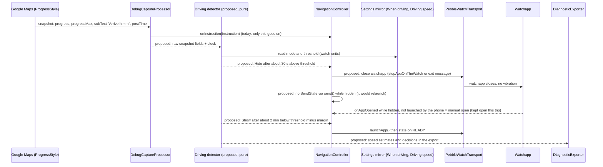

Text fallback: Google Maps' card carries the trip progress in metres and an "Arrive h:mm" sub-text; the snapshot already holds both, but the capture processor forwards only the parsed instruction. A proposed pure detector would read those raw fields with a clock and the two synced settings from the mirror, and tell the controller to hide after about 30 s above the threshold. The controller would then close the watchapp (no close call exists today) and must stop every state send that can relaunch it. If the user opens the watchapp while it is hidden (an app-opened callback the phone did not cause by its own launch), it stays open for the trip. After about 2 min below the threshold minus a margin the controller relaunches it. Speed estimates and decisions go to the diagnostics export.

### Watch settings sync (current, protocol 1.3, 61787f5)

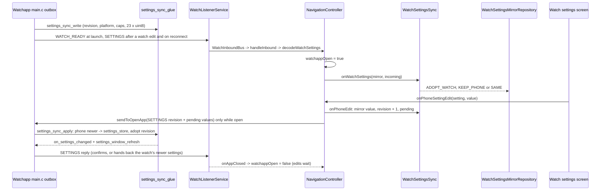

Text fallback: the watch writes its revision, platform, capabilities and all 23 settings as uint8 tuples into its READY at launch, into a SETTINGS message after each watch edit and again on reconnect. The phone decodes them only from a real READY or SETTINGS (the made-up READY carries none), marks the watchapp open, and merges them: the watch wins unless the phone has pending edits with a newer revision. A phone edit updates the mirror, moves the phone's revision on and goes out as SETTINGS with only the pending values, through the send that never relaunches, and only while the watchapp is open. The watch applies a newer phone set through `settings_store` (no echo), redraws, closes open doors, and always replies with its settings, which confirms the edit. An app-closed callback makes the phone hold edits again.

### A Vela Maps notification and its route-capture check (#120 target, c7b6ba0)

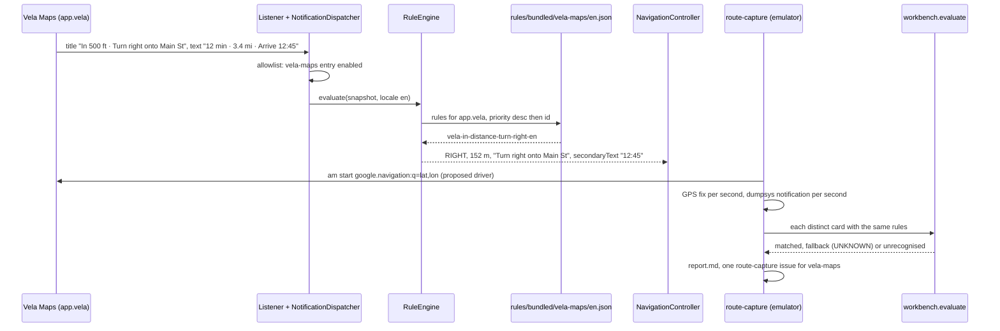

Text fallback: Vela posts the distance and instruction in the title and the duration, remaining distance and arrival time in the text. Once `app.vela` is in the catalog, the dispatcher admits it and the engine evaluates the Vela rules in priority order; the turn-right rule gives RIGHT, 152 m (500 ft), the instruction as the road line and the clock as the secondary text. A proposed route-capture driver starts Vela with the `google.navigation:` intent, replays the GPS track, and checks every captured card with the workbench copy of the engine.

### Install source to the dashboard row and the export (494a6dd, with the #119 touchpoints)

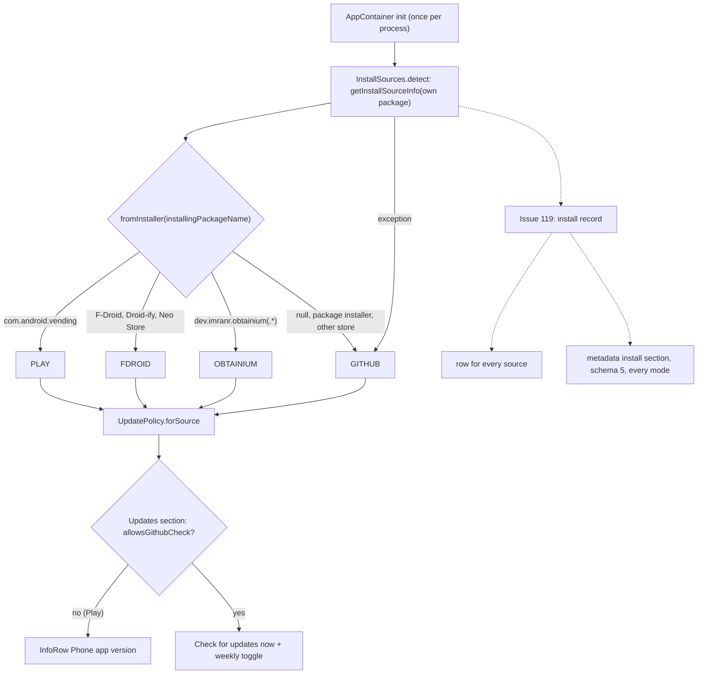

Text fallback: once per process `AppContainer` asks `PackageManager.getInstallSourceInfo` for its own package and maps `installingPackageName` to PLAY, FDROID, OBTAINIUM or GITHUB (also any failure). `UpdatePolicy` decides the update UI. #119 added one install record, read from the same lookup plus `PackageInfo` times, feeding a row for every source and an install section in every export (schema 5, present at 61787f5).

### Large-icon lookup for MicroG Maps with the fallback (2fa2aa5)

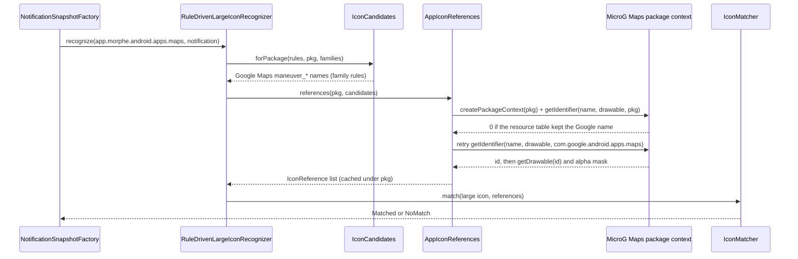

Text fallback: the recognizer takes its candidates from every enabled rule of the posting package's family. `AppIconReferences` looks each name up under the posting package and, on a miss, retries with the family's root package in the same context. The result is cached under the posting package.

### A MicroG Maps notification through the Google Maps rules (#113 target, 1c7f4c1)

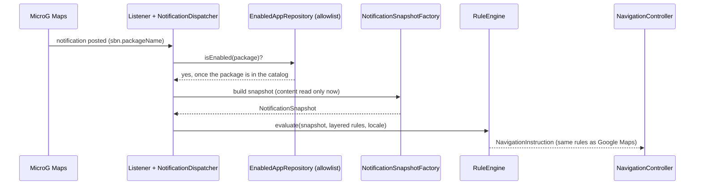

Text fallback: once the package is in the catalog the dispatcher admits it and the snapshot is built; the engine evaluates the Google Maps family's rules and the rest of the path to the watch is unchanged.

### Watch input and setting changes (current, 61787f5)

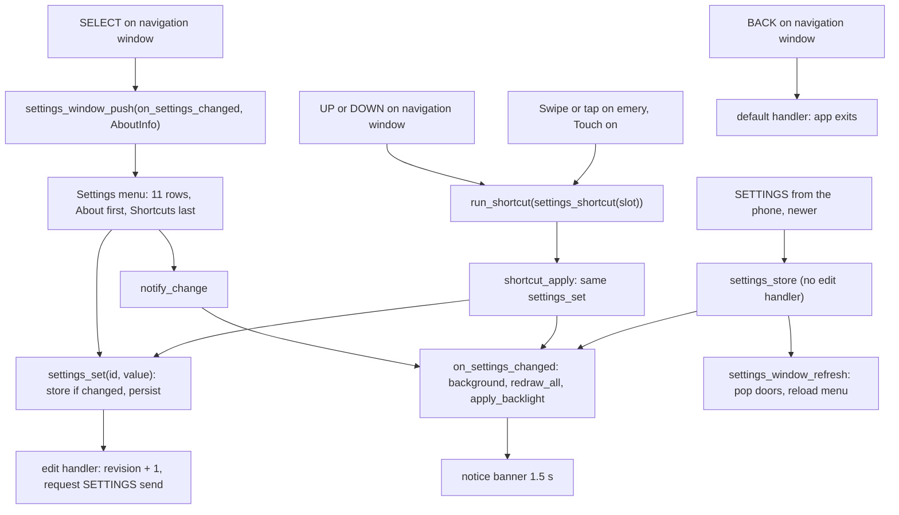

Text fallback: SELECT opens the 11-row settings menu (About first). A menu choice calls `settings_set`, which persists a changed value and runs the edit handler (revision + 1, SETTINGS to the phone), then `notify_change` re-applies the background, redraws and re-applies the backlight. UP, DOWN and, on emery while Touch is on, a swipe or a tap run the slot's action through the same setter, then a 1.5 s banner. A newer phone SETTINGS is applied through `settings_store` without counting as a watch edit, and the open menu closes its doors and reloads. BACK exits.

### Navigation update reaches the watch

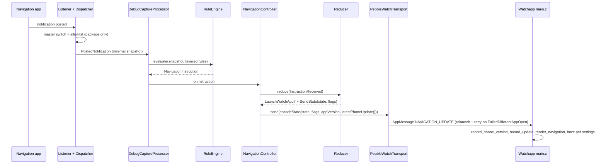

Text fallback: notification -> allowlist -> snapshot -> rule engine -> controller -> reducer effects -> codec (with the update fields) -> transport, which relaunches the watchapp once if the companion refuses delivery because another app is open -> the watch records the versions, renders and buzzes per its own vibration settings.

### Watch launch handshake

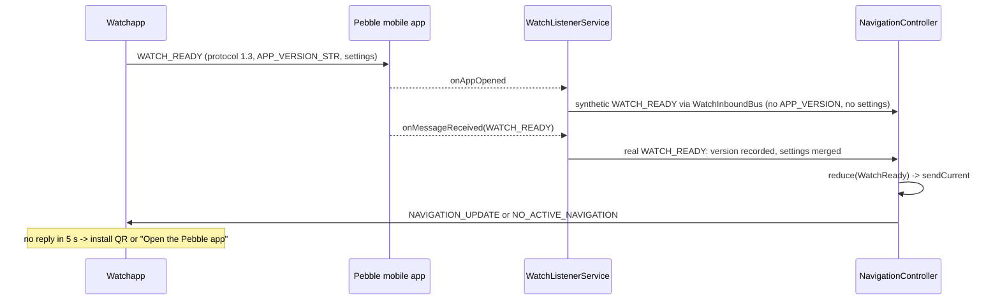

Text fallback: the watch sends READY with its version and settings; the companion reports "app opened" and the listener emits a synthetic READY without either. The real READY records the watchapp version and merges the settings. Either way the controller sends the current state. Without a reply in 5 s the watch shows a hint.

### Update check and #94 update notice (current behaviour)

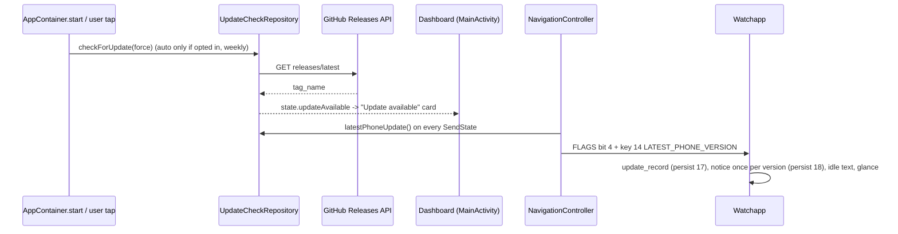

Text fallback: the GitHub check stores the latest tag; the dashboard shows the card; the controller adds bit 4 and key 14 to every state message while an update is known; the watch records it, shows the notice once per version when no route is active, swaps the idle text and sets the glance subtitle.

### Version-compare update (implemented in v0.0.73)

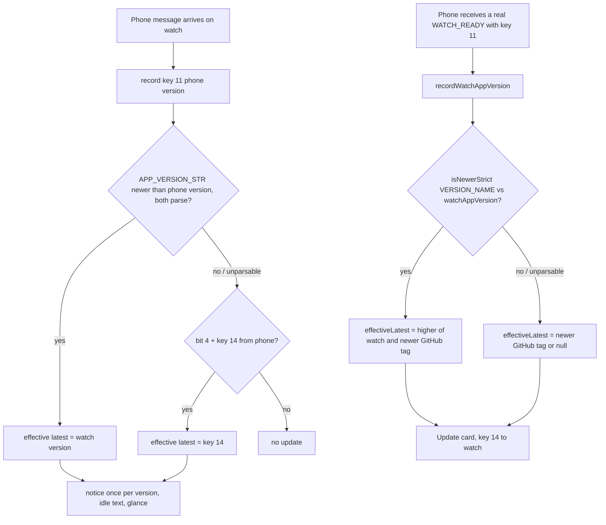

Text fallback: on the watch, a higher own version becomes the effective update version alongside the phone-reported bit 4/key 14. On the phone, a watch version is recorded only from a real WATCH_READY, and `effectiveLatest` is the higher of a strictly newer watch version and a newer GitHub tag.
