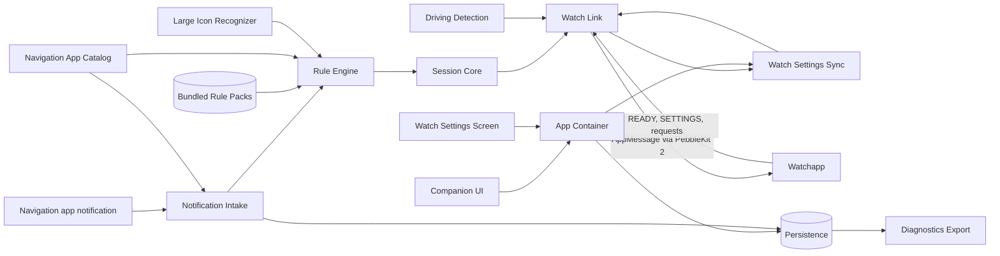
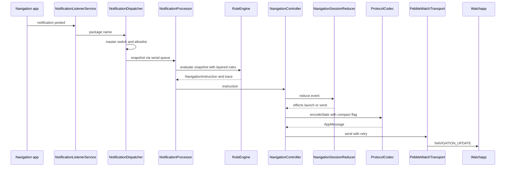
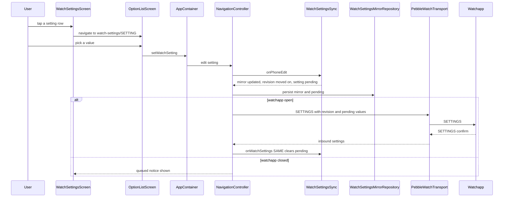
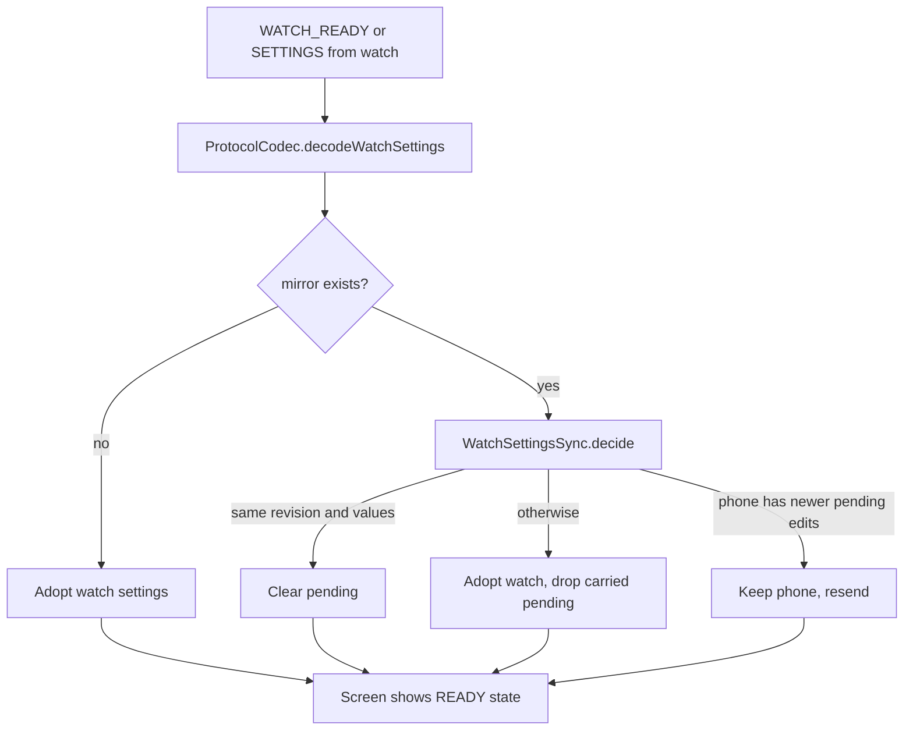

# Architecture

## Architecture Analysis

### System Overview

Two deployables talk over Bluetooth through the Pebble mobile app: the Android companion app (`android/app`, Kotlin, Jetpack Compose) and the Pebble watchapp (`watchapp/`, C). A shared AppMessage protocol definition (`protocol/protocol-definition.json`, 1.5) generates the constants for both sides. Rule packs, the app catalog and fixtures are JSON data under `rules/`, staged into the app at build time. Python tools support rule authoring, route capture, protocol generation and store graphics.

### Architectural Style

Client-side monolith per device, no backend. The Android app is a single module with feature packages, manual dependency injection (`di/AppContainer.kt`), pure Kotlin domain logic (rule engine, session reducer, settings sync) kept free of Android types, and Compose screens fed by `StateFlow`s. The watch is an event-driven C program (AppMessage inbox, timers, windows). Evidence: `core/` and `rules/` have no Android imports; `NavigationController` executes reducer effects; `WatchSettingsUi` is pure functions for the screen.

### Component Relationships

Text fallback: notifications enter Notification Intake, which uses the catalog and the rule engine (with bundled rule packs and the icon recognizer) to build an instruction. Session Core decides what to send; Watch Link encodes and sends it to the watchapp, also applying When driving and the watch settings mirror. The watchapp sends READY, SETTINGS and state requests back to Watch Link, which feeds Watch Settings Sync. The Companion UI and the Watch Settings Screen act through the App Container. Persistence stores history, rules and preferences, read by Diagnostics Export.

### Data Flow

1. `NavigationNotificationListenerService` → `NotificationDispatcher`: master switch and allowlist checked before any extras are read; an immutable `NotificationSnapshot` is queued on `SerialProcessingQueue`.
2. `NotificationProcessor` runs `RuleEngine.evaluate` (layered rules: user > downloaded > bundled; family and locale filtering) → `NavigationInstruction`; a debug event is recorded.
3. `NavigationController` feeds `NavigationSessionReducer`; effects (launch, send, stop) go to `PebbleWatchTransport` after `ProtocolCodec.encodeState` (road line Full or Compact from the watch settings mirror).
4. The watchapp renders and persists its own settings; it sends WATCH_READY (protocol minor, platform, capabilities, all settings) and SETTINGS on change.
5. Settings arriving at the phone are merged by `WatchSettingsSync.onWatchSettings` into the mirror (`WatchSettingsMirrorRepository`, DataStore); phone edits go through `onPhoneEdit` and are sent as SETTINGS only while the watchapp is open, else queued.

### Key Design Decisions

- **Privacy gate first** (AGENTS.md rules 7-9): no content read before the allowlist; no automatic upload.
- **Declarative rules only** (rule 6): no remote code; strict JSON with a closed extractor set.
- **Generated protocol constants** (rule 5) checked in CI on both sides.
- **Watch owns its settings**: the phone keeps a mirror with revisions 0-99 (wrapping, 50-apart tie goes to the watch); the same rule is implemented in `WatchSettingsSync.kt` and `watchapp/src/c/revision.c` / `settings_sync.c`.
- **Capability-driven settings UI**: `WatchSettingsRules.isOffered` hides settings the watch cannot use; protocol minor gates When driving (1.4) and the watch-side Directions text (1.5).
- **Pure screen rules**: `WatchSettingsUi` decides sections, rows, labels and previews without Compose, so they are unit-tested on the JVM.
- **Vendored PebbleKit 2** and reproducible release builds for F-Droid.

### Improvement Opportunities

- Watch settings titles and labels exist twice (watch C strings and phone resources) with no shared source.
- No per-setting help text on the phone or the watch (issue #139 addresses the phone).
- English-only resources; no localisation path yet.
- Large files (`main.c`, `settings_window.c`, `DashboardScreen.kt`, `MainActivity.kt`) concentrate many responsibilities.
- No coverage measurement.

## Interaction Diagrams

### Notification to watch

Text fallback: the listener hands the package to the dispatcher, which checks the master switch and allowlist, then queues a snapshot. The processor evaluates it with the rule engine and passes the instruction to the controller, whose reducer returns effects. The controller encodes the state (Full or Compact road line) and the transport sends NAVIGATION_UPDATE to the watchapp.

### Phone Watch settings edit to watch

Text fallback: tapping a row opens the option list; picking a value calls `setWatchSetting` on the container, which asks the controller to apply `WatchSettingsSync.onPhoneEdit` (mirror updated, revision incremented, setting pending) and persist it. If the watchapp is open, the controller sends SETTINGS and the watch's reply confirms it; otherwise the edit waits and the screen says "Will apply when the watchapp next opens". The When driving section edits values in place through the same `onChangeSetting` path.

### Watch settings arriving from the watch

Text fallback: inbound settings are decoded; with no mirror they are adopted. Otherwise the revision rule keeps newer phone edits, confirms identical ones, or adopts the watch's values. A pre-1.5 watchapp's missing Directions text keeps the phone's value.
