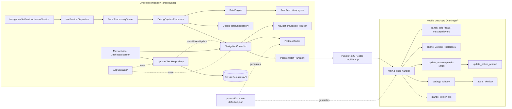
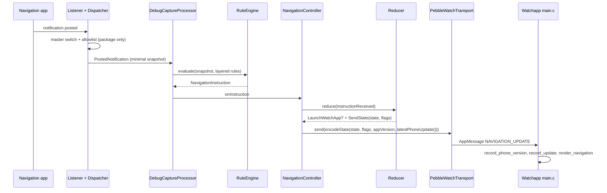
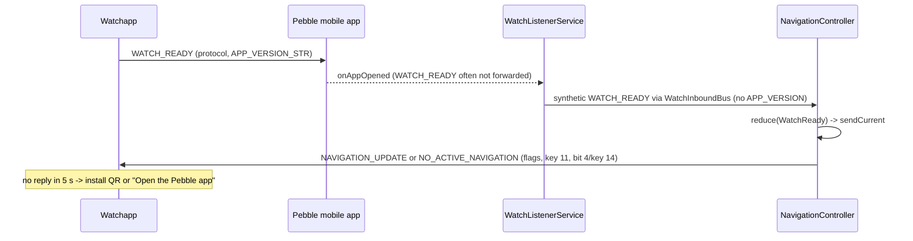
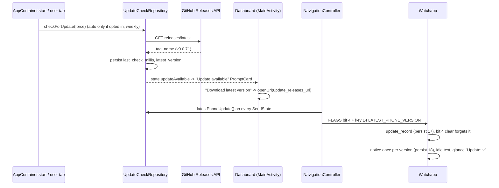
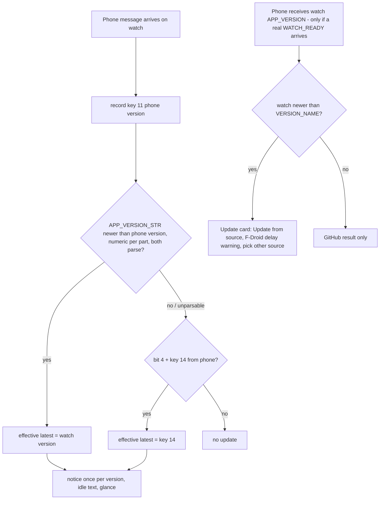

# Architecture

## Architecture Analysis

### System Overview

A two-device monorepo. The Android companion (`android/app`, Kotlin/Compose) observes navigation notifications, normalizes them through a declarative rule engine and a pure session reducer, and pushes one current state to the Pebble watchapp (`watchapp/`, C) over PebbleKit Android 2 AppMessages. One JSON protocol definition (`protocol/`) generates the constants for both sides. Rule data, schemas and maintainer tools live beside the code.

### Architectural Style

A client-side, offline monolith per device, with a hexagonal flavour on the phone. Pure domain cores (`core/NavigationSessionReducer`, `rules/RuleEngine`, `protocol/ProtocolCodec`) are isolated from Android and PebbleKit behind interfaces (`WatchTransport`, `AppAllowlist`, `ReleaseFetcher`, `EpochClock`). Wiring is manual through `di/AppContainer` (no Hilt, by the coding standards). The watch is a single-window event loop that keeps pure, host-testable text modules apart from Pebble API code. There is no backend. The only network call is the GitHub Releases GET.

### Component Relationships

Text fallback: listener -> dispatcher (allowlist gate) -> serial queue -> capture processor -> rule engine -> navigation controller -> reducer -> codec -> PebbleKit transport -> Pebble mobile app -> watchapp inbox -> layers, phone-version record and update-notice record. UpdateCheckRepository calls GitHub and hands the newer version to the controller (`latestPhoneUpdate`). AppContainer wires everything. The protocol JSON generates the Kotlin and C constants.

### Data Flow

1. A notification is posted. The master switch and package allowlist are checked on the package name only, and then a minimal snapshot is taken (no icons except rule-driven large-icon matching).
2. The rule engine produces a `NavigationInstruction`. Debug history stores the snapshot and trace, with keys hashed.
3. The controller reduces it into a `NavigationState` and effects (`LaunchWatchApp`, `SendState(state, flags)`, `SendCompatibilityError`). Flags are computed in the reducer from `WatchSettings` and staleness.
4. `ProtocolCodec.encodeState(state, flags, appVersion, latestPhoneVersion)` builds an `AppMessage`, always with protocol major/minor and `APP_VERSION`. When `latestPhoneVersion` is set, it ORs in flag bit 4 and adds key 14. Text is fitted to the watch buffers (64/24 UTF-8 bytes).
5. `PebbleWatchTransport.send` delivers it, with one relaunch-and-retry on `FailedDifferentAppOpen`. The controller retries up to 3 times with backoff.
6. The watch decodes the tuples, records the phone version (persist key 16) and the update state (key 17), renders, may show the update notice, and sets the glance when it exits.
7. Watch to phone: `WATCH_READY` (or a synthetic one from `onAppOpened`, or an autonomous READY 1.5 s after a launch) triggers a resend of the current state. The phone reads only the protocol major/minor from it.

### Version Exchange (both directions)

- **Phone to watch**: key 11 `APP_VERSION` (`BuildConfig.VERSION_NAME`) on every state message, recorded and persisted on change by the watch (`phone_version_update`, main.c `record_phone_version`). The watch's own version is `APP_VERSION_STR` in main.c, kept equal to the phone's version line by `scripts/version.sh`.
- **Watch to phone**: key 11 only inside the watch's real `WATCH_READY`, sent once from `init()`. The phone ignores it (`decodeInbound`), and the synthetic READYs carry no version. On the Core Devices companion the real READY is not forwarded at all. PebbleKit 2 reports watch firmware version only. So today the phone has no reliable source for the watchapp version. This is the main design constraint for this intent; see [code-quality-assessment.md](code-quality-assessment.md).

### Key Design Decisions

- **One state, never a queue** (REQ-ANDROID-010): newer state replaces pending state. It is persisted in Room for process recovery.
- **Generated protocol constants** with a DO-NOT-EDIT banner and a `--check` gate in CI and pre-commit. They must stay consistent with the integrity-protected `examples/protocol-definition.json`.
- **Synthetic readiness**: the Core Devices companion does not forward `WATCH_READY`, so the phone synthesizes it.
- **Phone-wide update bit applied in the codec** (#94): `encodeState` adds bit 4 + key 14 on every state message, so the reducer's per-state flags stay unchanged and NO_ACTIVE_NAVIGATION also carries it.
- **The watch mirrors the phone's update bit**: bit 4 clear means "forget the recorded update" (`update_record`). The phone is today the only authority on "update available".
- **Privacy by construction**: allowlist before content, no automatic upload, network used only for the update check, which is opt-in for automatic runs.
- **Vendored PebbleKit 2** for F-Droid reproducibility.
- **Pure C units** for watch logic that can be tested on the host, one unit per test binary.

### Improvement Opportunities

- Split `watchapp/src/c/main.c` (1,248 lines) into decoding, rendering and lifecycle units, and validate tuple types.
- Add coverage tooling (Kover or JaCoCo) and a lint baseline.
- For this intent, make "update available" a derived value on each device that combines the phone's GitHub result with the version comparison, instead of a single overwritten record.

## Interaction Diagrams

### Navigation update reaches the watch

Text fallback: notification -> allowlist -> snapshot -> rule engine -> controller -> reducer effects -> codec (with the update fields) -> transport -> the watch records the versions and renders.

### Watch launch handshake

Text fallback: the watch sends READY with its version; the companion usually reports only "app opened"; the listener emits a synthetic READY without a version; the controller sends the current state. Without a reply in 5 s the watch shows a hint.

### Update check and #94 update notice (current behaviour)

Text fallback: the GitHub check stores the latest tag. The dashboard shows the card, and its button opens the GitHub releases page. The controller adds bit 4 and key 14 to every state message while an update is known. The watch records it, shows the notice once per version when no route is active, swaps the idle text and sets the glance subtitle. A message with bit 4 clear erases it.

### Version-compare update (target flow for this intent)

Text fallback: on the watch, the received phone version is compared with the watch's own version, and a higher watch version becomes the effective update version alongside the phone-reported bit 4/key 14. Unparsable versions are ignored. On the phone, a watch version is only available when a real WATCH_READY is forwarded. When it is higher, the card shows "Update from {source}" with the F-Droid delay warning and a source picker. Otherwise only the GitHub result applies. This is a proposal shape, not existing code.
