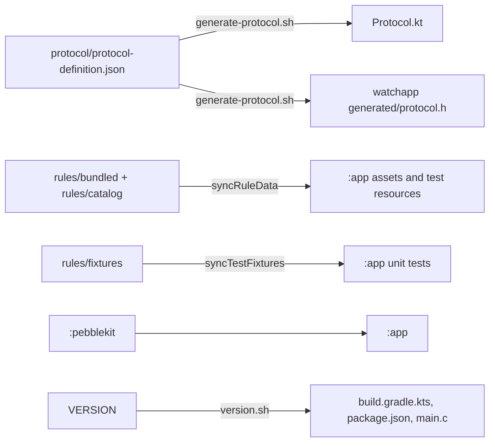

# Dependencies

Versions are listed once in [technology-stack.md](technology-stack.md); this file covers how things depend on each other.

## Build-time Module and Data Dependencies

Text fallback: the protocol definition generates the Kotlin and C constants; bundled rules and the catalog are staged into app assets and test resources; fixtures go to unit tests only; `:app` depends on the vendored `:pebblekit`; `VERSION` is kept in sync with Gradle, `package.json` and `main.c`.

## External Dependencies

| Dependency | Used by | Kind |
|---|---|---|
| AndroidX, Compose, Room, DataStore, kotlinx, Timber | `:app` | Maven (google, mavenCentral) |
| kermit, androidx.annotation | `:pebblekit` | Maven |
| Pebble mobile app (Core Devices / Rebble) | runtime | Bluetooth bridge the PebbleKit 2 client talks to |
| Navigation apps (Google Maps, OsmAnd, ...) | runtime | Notification source, never linked |
| Pebble SDK 3 / pebble-tool | watch build | Toolchain |
| jsonschema, Pillow, PyYAML | Python tools, CI | pip (Pillow and PyYAML optional) |
| GitHub Releases API | `update/ReleaseFetcher` | Optional HTTPS GET |

## Internal Package Dependencies (Android)

| Package | Depends on |
|---|---|
| `ui/watchsettings` | `core` (WatchSetting, WatchSettingsModel, WatchSettingsRules, WatchSettingsSyncState, PreviewCatalog, DrivingSpeeds), `R` resources |
| `ui` (other) | `core`, `data`, `rules`, `export`, `update`, `catalog`, `di` |
| `pebble` | `core`, `protocol`, `data`, PebbleKit 2 |
| `notification` | `rules`, `core`, `data`, `catalog` |
| `rules` | `core`, `catalog`, kotlinx.serialization (no Android) |
| `core` | `protocol` constants only (no Android) |
| `data` | `core`, Room, DataStore |
| `export` | `data`, `core` |
| `di` | everything (composition root) |

No circular package dependencies were seen; `core` and `rules` stay Android-free.

## Watch Settings Change Surface (intent focus)

A help-text change on the phone touches `ui/watchsettings/` (rendering and mapping), `res/values/strings.xml` (new strings), `ui/watchsettings` tests, and possibly `requirements/REQ-ANDROID.md` / `spec/400-ui/AndroidUI.md` (which then need `MANIFEST.sha256.json` updated). It does not touch the protocol, sync, watchapp or rules. Downstream: `StoreScreenshotsTest` output and fastlane screenshots if regenerated.
