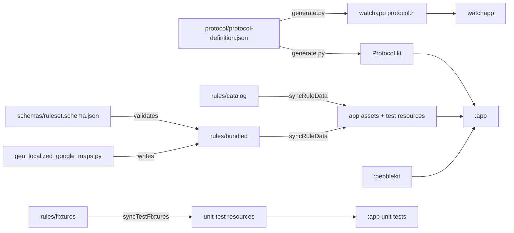

# Dependencies

External library versions are listed once in [technology-stack.md](technology-stack.md). This file records how modules, packages, data and tools depend on each other.

## Build-Time Module Graph

Text fallback: the protocol definition generates the Kotlin and C constants; Gradle stages the catalog and bundled rules into app assets and unit-test resources and the fixtures into unit-test resources only; `:app` depends on the vendored `:pebblekit`; the Google Maps generator writes seven localized rulesets; the JSON schema validates every bundled ruleset.

## Internal Package Dependencies (`com.pebblentn.app`)

| Package | Depends on |
|---|---|
| `notification` | `rules` (engine, repository), `core` (instruction, clock, `SpeedSample`, allowlist), `data` (debug history), `notification.icon` |
| `notification.icon` | `rules` (rules as icon candidates), `catalog` (families) |
| `rules` | `notification` (`NotificationSnapshot`), `core` (`NavigationInstruction`, `Maneuver`, `EpochClock`), `catalog` (`RuleFamilies`) |
| `core` | `protocol` (generated codes for `Maneuver`, flags) |
| `pebble` | `core` (reducer, driving), `protocol` (codec, transport), `data` (state, mirror, driving log), PebbleKit 2 |
| `protocol` | `core` (state, settings models) |
| `data` | `core`, `rules` (user rules, trace types), `data.db` (Room) |
| `export` | `data`, `rules` |
| `update` | `data.db` (official rulesets), `rules` (codec) |
| `ui` | all of the above through `di.AppContainer` |
| `di` | everything (composition root) |

Cycle note: `notification` ↔ `rules` reference each other (the engine reads `NotificationSnapshot`; the capture processor calls the engine). It is a type-level cycle inside one module, not a runtime problem.

## Data Dependencies of the Rule Engine (#134 focus)

| Consumer | Reads | Coupling |
|---|---|---|
| `AssetRuleRepository` | every `.json` under `assets/rules/bundled/` recursively | File layout does not affect matching (REQ-RULE-015) |
| `RuleEngine` | `packageNames` (with catalog rule families), `locales`, `priority`, `id` | Phone locale's language must be in `locales` |
| Watch `main.c` | `SECONDARY_TEXT` as an arrival string, `ETA_EPOCH_SECONDS` | Secondary text is parsed for `H:MM` by `eta_parse_clock_minutes` |
| `NavigationSessionReducer` | instruction equality | Any per-second change in `etaEpochSeconds` causes a resend |
| `DrivingSpeedEstimator` | Google Maps `subText` arrival clock and progress | Separate clock parsing from the rule engine |
| Kotlin regression tests | `/rules/bundled/<app>/*.json`, `/fixtures/<app>.json` from staged resources | Language list hard-coded per test (OsmAnd: en, it, de, fr, es, nl, pt, pl, zh) |
| `workbench.py regression` | `rules/bundled/<app>/*.json`, `rules/fixtures/<app>.json`, catalog | Needs a matching Python implementation of every extractor and output used |

## Change Coupling for a New Extractor Type

`schemas/ruleset.schema.json` (protected: update `MANIFEST.sha256.json`) → `rules/RulesetModel.kt` (serial name) → `rules/ExtractorRunner.kt` → `rules/RuleEngine.kt` (`assemble` epoch handling) → `rules/RuleValidator.kt` (if the extractor has a regex) → `tools/rule-workbench/workbench.py` (`run_extractor`, `evaluate`, `check_fixture`) → `requirements/REQ-RULES.md` and `spec/200-architecture/RuleEngine.md` (protected) → fixtures and both regression tests. Rule editor UI (`ui/rules/RuleEditorScreen.kt`, `RuleTemplates.kt`) shows outputs and may need a label.

## External Runtime Dependencies

| Dependency | Used by | Failure behaviour |
|---|---|---|
| Android notification listener access | Notification Intake | Onboarding blocks until granted; `NotificationListenerRefresher` rebinds when silent |
| Pebble mobile app (Core / Rebble) and PebbleKit 2 provider | Watch Link | `SendResult.FAILED`, retry; `WatchLink` status on the dashboard |
| GitHub releases API (optional) | Updates | Offline check stays the default; never on Play installs |
| Public OSM routers (routing.openstreetmap.de) | Route Capture Harness only | Tracks cached and committed under `routes/cache/` |
| `gh` CLI | Route capture `--publish` | Optional |
