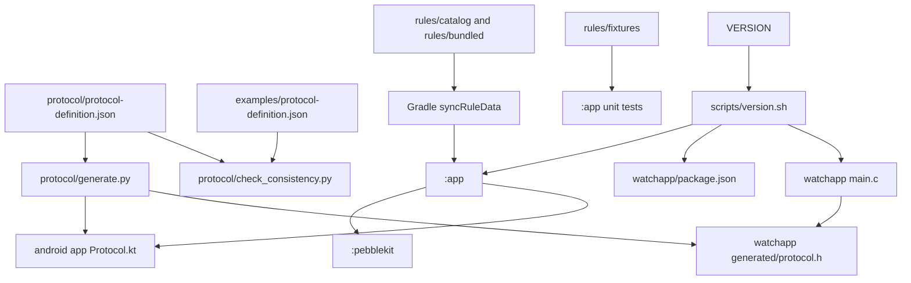

# Dependencies

## External Dependencies (Android, from android/gradle/libs.versions.toml)

| Library | Version | Scope | Role |
|---|---|---|---|
| androidx.core:core-ktx | 1.15.0 | implementation | Kotlin extensions |
| androidx.lifecycle (runtime-ktx, viewmodel-compose) | 2.8.7 | implementation | lifecycle, view models |
| androidx.activity:activity-compose | 1.9.3 | implementation | Compose host |
| androidx.navigation:navigation-compose | 2.8.5 | implementation | screen navigation |
| androidx.compose BOM (ui, graphics, material3, icons-core, tooling) | 2024.12.01 | implementation / debug | UI |
| androidx.room (runtime, ktx, compiler via KSP, testing) | 2.7.2 | implementation / ksp / test | database |
| androidx.datastore:datastore-preferences | 1.1.1 | implementation | settings |
| kotlinx-serialization-json | 1.7.3 | implementation | rules, export JSON |
| kotlinx-coroutines-android | 1.9.0 | implementation | concurrency |
| com.jakewharton.timber | 5.0.1 | implementation | logging |
| co.touchlab:kermit | 2.0.4 | :pebblekit | PebbleKit 2 logging |
| androidx.annotation | 1.9.1 | :pebblekit | annotations |
| junit 4.13.2, robolectric 4.14.1, kotlinx-coroutines-test 1.9.0, androidx.test core 1.6.1 | - | test | unit tests |
| androidx.test.ext:junit 1.2.1, espresso-core 3.6.1 | - | androidTest | instrumentation |

Repositories: `google()`, `mavenCentral()` only (`FAIL_ON_PROJECT_REPOS`); no JitPack.

## External Dependencies (other)

- **Pebble SDK 3** and `pebble-tool` (installed in CI with `pip install pebble-tool`, `pebble sdk install latest`, unpinned).
- **Python**: standard library; `jsonschema` for scripts/validate_rules.py and validate_catalog.py.
- **Runtime services**: a PebbleKit 2 companion app on the phone (Core Devices / Rebble Pebble app); GitHub Releases API for update checks.
- **CI actions**: actions/checkout@v7, setup-java@v5, setup-python@v6, android-actions/setup-android@v4, actions/cache@v6, upload-artifact@v7, CodeQL.

## Internal Dependencies

Text fallback: protocol-definition.json feeds generate.py, which writes Protocol.kt (used by :app) and protocol.h (used by the watchapp); check_consistency.py compares it with the examples copy. :app depends on :pebblekit. Gradle `syncRuleData` stages rules/catalog and rules/bundled into :app assets and test resources; rules/fixtures go to unit tests only. VERSION is propagated by scripts/version.sh to app/build.gradle.kts, watchapp/package.json and `APP_VERSION_STR` in main.c.

## Cross-Component Couplings to Preserve

- Watchapp UUID `9c7cef54-517e-42c8-8e95-0a8316e70cf1` appears in watchapp/package.json and `PebbleWatchTransport.PEBBLENTN_UUID`.
- `companionApp.android.apps[].package = com.pebblentn.app` in package.json is required for the companion to route messages (spec/200-architecture/Pebble.md).
- Text byte budgets: `PRIMARY_TEXT_MAX 64` / `SECONDARY_TEXT_MAX 24` in main.c match `ProtocolCodec.MAX_PRIMARY_BYTES` / `MAX_SECONDARY_BYTES`.
- On the watch, `AboutInfo` is built in main.c and passed through settings_window.c to about_window.c; adding a field touches all three.
